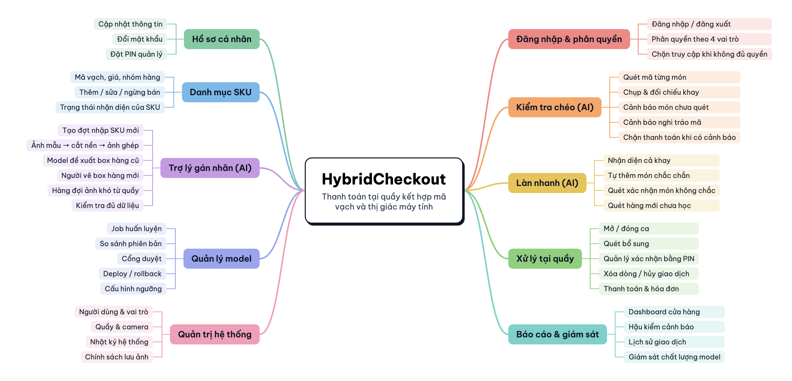
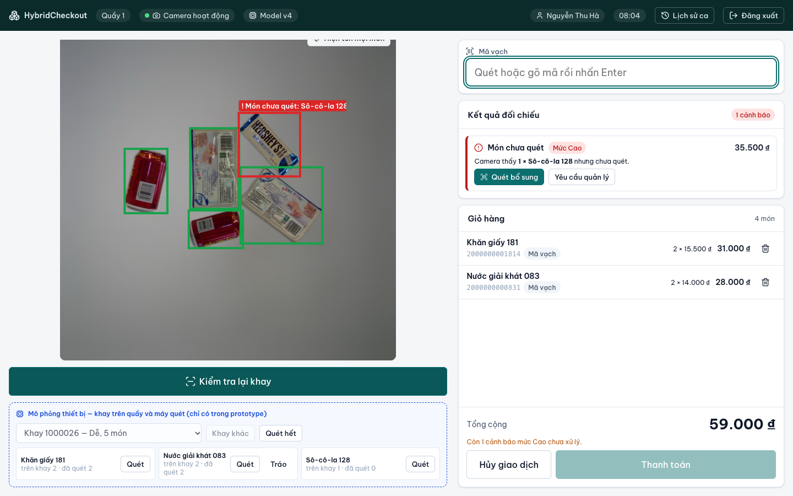
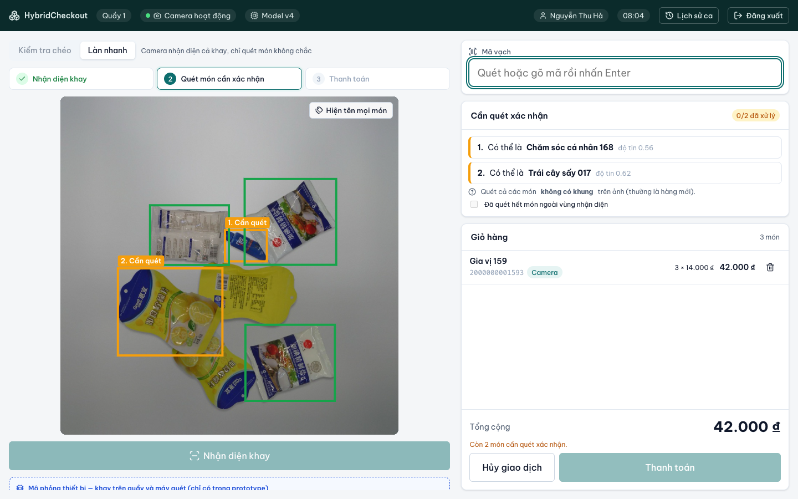
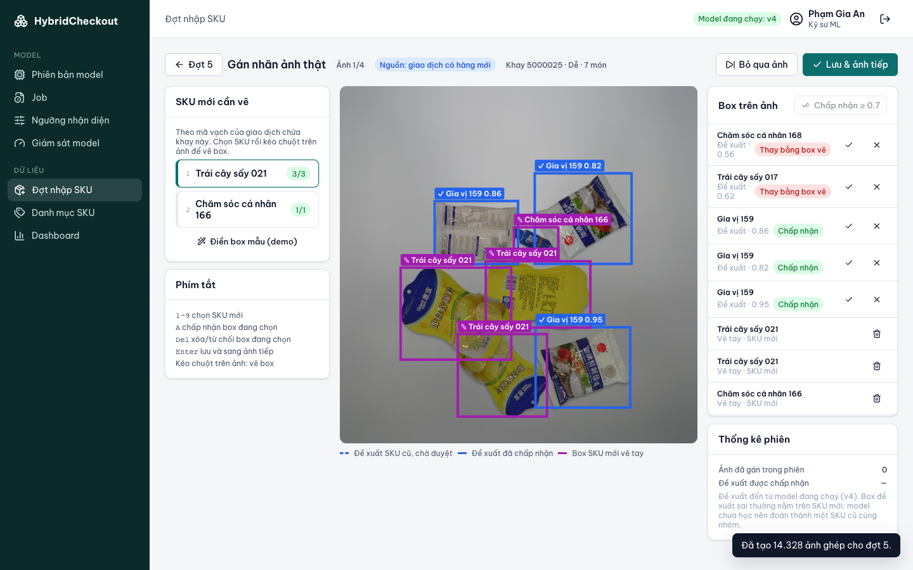

# HybridCheckout

**Hệ thống thanh toán tại quầy kết hợp mã vạch và thị giác máy tính.**

Mã vạch tính tiền, camera kiểm tra khay. Trước khi khách trả tiền, camera chụp khay và hệ thống so với danh sách đã quét để phát hiện món chưa quét và tráo mã. Khi cửa hàng nhập hàng mới, model nhận diện học thêm SKU mới mà không phải train lại từ đầu.

## 1. Yêu cầu

### 1.1 Product mind map



### 1.2 Ba tính năng AI

| Tính năng | Làm gì |
|---|---|
| **Kiểm tra chéo** | Thu ngân quét mã như thường; camera đối chiếu khay và cảnh báo *món chưa quét*, *nghi tráo mã* trước khi thanh toán |
| **Làn nhanh** | Camera nhận diện cả khay, tự thêm món chắc chắn; thu ngân chỉ quét món không chắc và hàng mới |
| **Trợ lý gán nhãn** | Khi nhập hàng mới: AI cắt nền ảnh chụp từng sản phẩm để ghép thành ảnh **huấn luyện**; trên ảnh khay thật, model đề xuất box hàng cũ, người chỉ vẽ hàng mới để tạo tập **kiểm tra** |

### 1.3 Use case


Mọi vai trò dùng chung UC01 Đăng nhập, UC02 Đăng xuất, UC03 Hồ sơ cá nhân. Sơ đồ chi tiết, 28 user story INVEST và tiêu chí chấp nhận ở [Bước 2](docs/02-use-case-user-stories.md).

### 1.4 Vai trò và quyền

| Chức năng | Thu ngân | Quản lý | Kỹ sư ML | Quản trị viên |
|---|:-:|:-:|:-:|:-:|
| Bán hàng tại quầy, xử lý cảnh báo | ✓ | ✓ | | |
| Xác nhận bằng PIN | | ✓ | | |
| Dashboard, hậu kiểm, danh mục SKU, đợt nhập | | ✓ | Xem | |
| Tải ảnh mẫu | | ✓ | ✓ | |
| Duyệt ảnh mẫu, gán nhãn, huấn luyện, deploy model, ngưỡng | | | ✓ | |
| Người dùng, quầy/camera, lưu dữ liệu | | | | ✓ |

Phân quyền kiểm tra ở backend; ẩn nút trên giao diện chỉ để tiện dùng.

## 2. Kiến trúc thông tin và giao diện

```text
Đăng nhập
├── QUẦY (Thu ngân, Quản lý)
│   ├── Mở ca
│   ├── Quầy — Kiểm tra chéo / Làn nhanh   (+ hộp thoại PIN, Thanh toán)
│   └── Lịch sử ca & Đóng ca
└── QUẢN TRỊ
    ├── Cửa hàng: Dashboard · Cảnh báo & Hậu kiểm · Giao dịch · Danh mục SKU · Đợt nhập
    ├── Model:    Ảnh mẫu & ảnh ghép · Gán nhãn ảnh thật · Job · Phiên bản & Cổng duyệt · Ngưỡng · Giám sát
    ├── Quản trị: Người dùng · Quầy & Camera · Nhật ký · Cài đặt lưu trữ
    └── Hồ sơ cá nhân
```

**Kiểm tra chéo** — camera phát hiện món chưa quét, khóa thanh toán đến khi xử lý:


**Làn nhanh** — món chắc chắn tự vào giỏ, món không chắc chờ quét:


**Trợ lý gán nhãn** — trên ảnh khay thật, duyệt đề xuất hàng cũ, vẽ hàng mới:


## 3. Chạy prototype

```bash
python3 scripts/prepare_samples.py --model-repo <đường dẫn repo model>
cd frontend && npm install && npm run dev      # http://localhost:5173
```

Chọn một tài khoản demo trên trang đăng nhập. Kịch bản demo 5 phút: [Bước 4, mục 9](docs/04-ui-ux.md#9-kịch-bản-demo-5-phút).

## Tài liệu

| Bước | Tài liệu |
|---|---|
| 1 | [Phân tích đề bài](docs/01-phan-tich-de-bai.md) |
| 2 | [Mind map, Use case, User story INVEST](docs/02-use-case-user-stories.md) |
| 3 | [Kiến trúc thông tin](docs/03-information-architecture.md) |
| 4 | [UI/UX](docs/04-ui-ux.md) |

## Tiến độ

- [x] Phân tích đề bài
- [x] Mind map, use case, user story INVEST
- [x] Kiến trúc thông tin
- [x] UI/UX và prototype
- [ ] DBML / ER
- [ ] OpenAPI
- [ ] C4
- [ ] Cấu trúc code
- [ ] Code

Ảnh khay lấy từ bộ RPC (Wei et al., 2019), CC BY-NC-SA 4.0, không đưa ảnh gốc lên repo. Tên SKU, giá và mã vạch là dữ liệu tự tạo.
# hybrid-checkout
