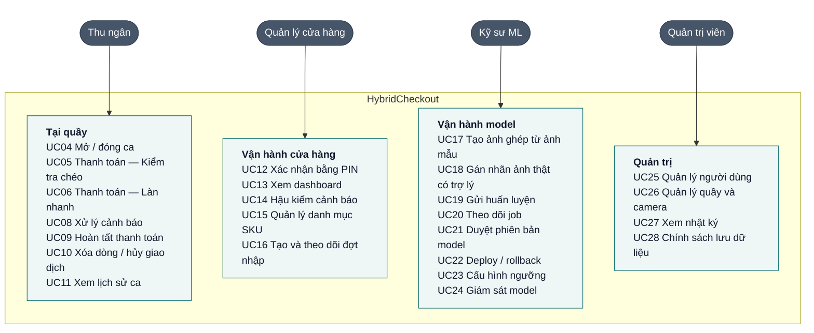
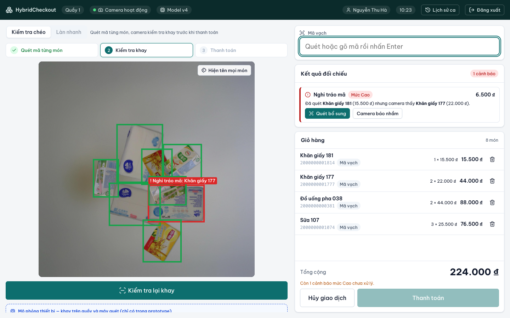
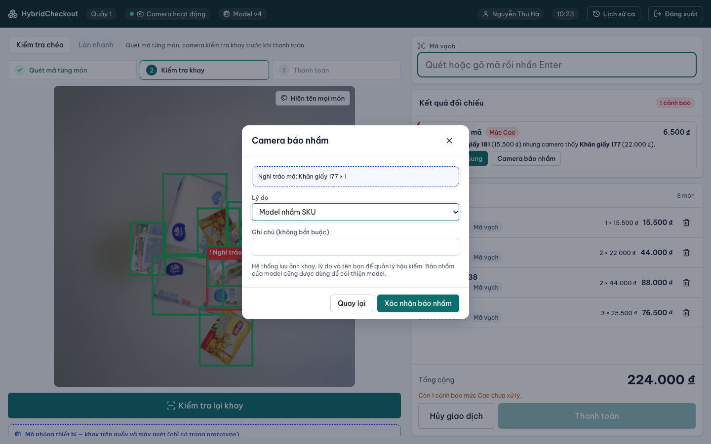
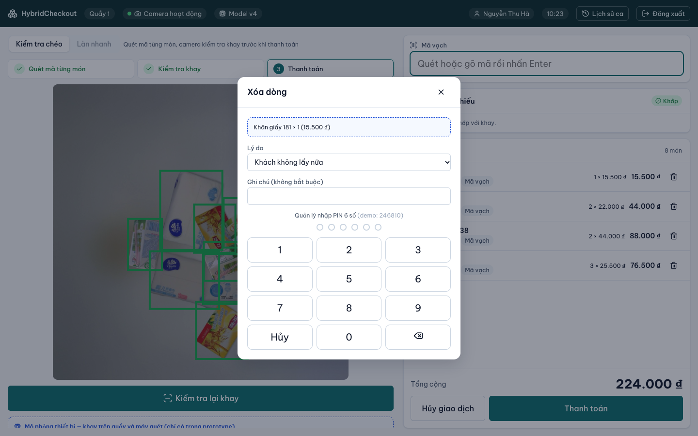
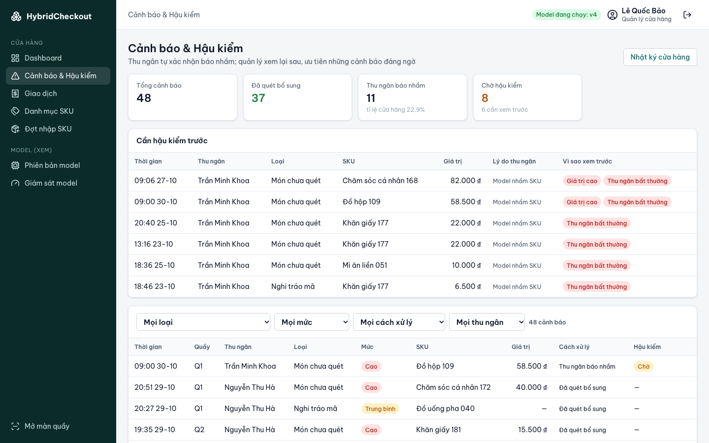
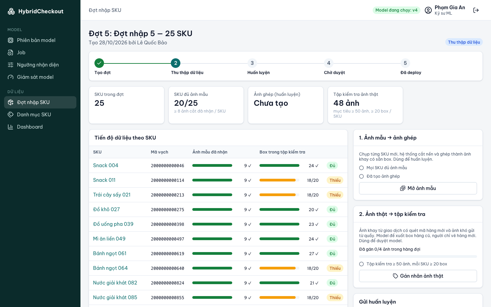
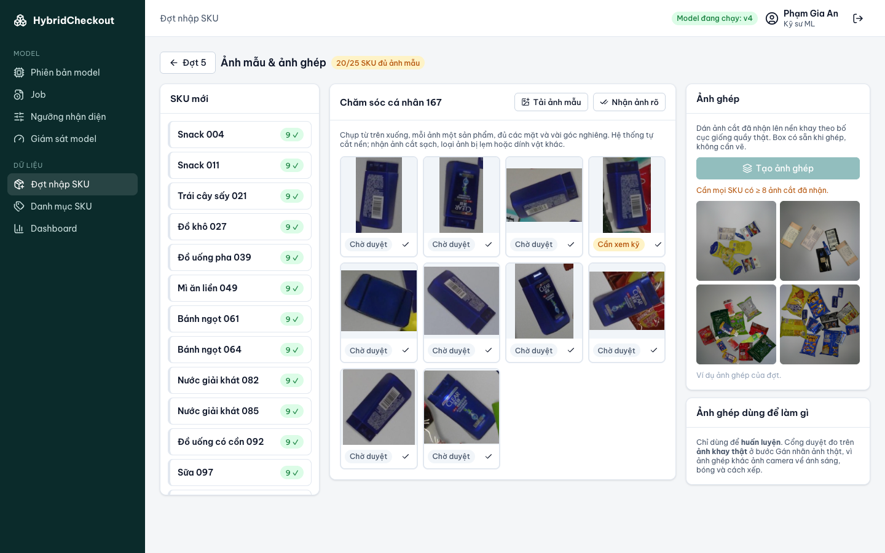
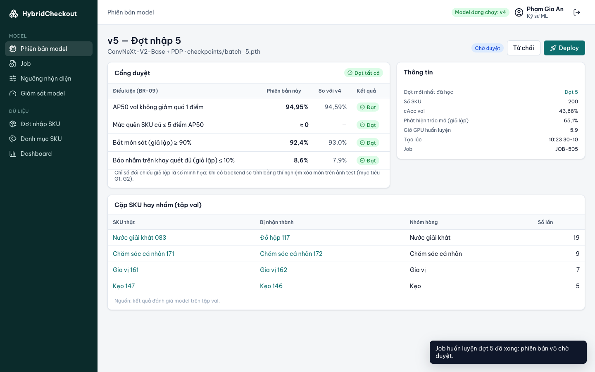
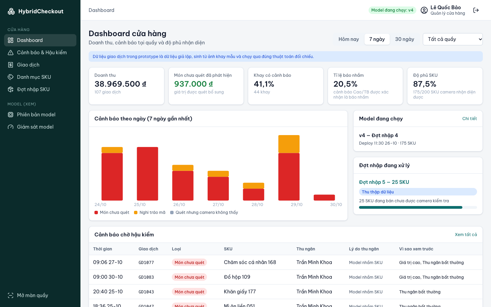

# HybridCheckout

**Hệ thống thanh toán tại quầy kết hợp mã vạch và thị giác máy tính.**

Thu ngân vẫn quét mã vạch để tính tiền. Trước khi khách trả tiền, camera trên quầy chụp khay hàng, hệ thống so với danh sách đã quét và báo **món chưa quét** hoặc **nghi tráo mã**. Khi cửa hàng nhập hàng mới, model nhận diện học thêm SKU mới theo đợt mà không train lại từ đầu.

## 1. Phân tích đề bài

### 1.1 Vấn đề

POS chỉ biết những món **đã được quét**. Món quét sót, cố ý bỏ qua hoặc quét mã món rẻ cho món đắt đều không để lại dấu vết. Thất thoát bán lẻ ở Mỹ khoảng 1,6% doanh thu (NRF, 2022).

| | Vấn đề | Xảy ra ở |
|---|---|---|
| P1 | Thất thoát POS không thấy: quét sót, cố ý không quét, tráo mã | Tại quầy |
| P2 | Chậm giờ cao điểm: khay 10–20 món phải quét từng món | Tại quầy |
| P3 | Camera không theo kịp hàng mới; train lại từ đầu mỗi đợt thì tốn GPU | Hậu trường |
| P4 | Dữ liệu mỗi đợt tốn công: vẽ box tay rất lâu; ảnh ghép thì rẻ nhưng khác ảnh camera thật | Hậu trường |

**Giải pháp hiện có:** camera theo dõi thu ngân (StopLift) chủ yếu hậu kiểm sau khi khách đã đi; kiosk nhận diện cả khay (Mashgin) cần phần cứng nhiều camera; Amazon Just Walk Out đã bị gỡ khỏi chuỗi Fresh (2024). Rút ra: camera **hỗ trợ** người thì đang chạy thực tế, camera **thay** người thì chưa đủ tin cậy. Cảnh báo phải có **trước khi khách trả tiền**.

### 1.2 Hướng giải pháp

- **Mã vạch quyết định hóa đơn, camera kiểm tra và tăng tốc.** Model đúng từng món rất cao nhưng đúng cả khay thấp hơn nhiều vì sai số cộng dồn: mỗi món đúng 97% thì khay 15 món chỉ đúng hết 0,97¹⁵ ≈ 63%.
- **Chỉ làm quầy có thu ngân.** Đây là mô hình phổ biến ở Việt Nam, và có người xử lý cảnh báo ngay tại chỗ.
- **Mã vạch còn giúp camera:** khi khay có hàng model chưa học, mã vạch báo trước nên hệ thống không cảnh báo nhầm ở món đó.

| Tính năng AI | Làm gì | Giải quyết |
|---|---|---|
| **1. Kiểm tra chéo** | Thu ngân quét mã như thường. Bấm "Kiểm tra khay", camera đối chiếu và cảnh báo *món chưa quét*, *nghi tráo mã*. Cảnh báo mức Cao khóa nút Thanh toán | P1 |
| **2. Làn nhanh** | Camera nhận diện cả khay, tự thêm món chắc chắn; thu ngân chỉ quét món không chắc và hàng mới | P2 |
| **3. Trợ lý gán nhãn** | Khi nhập hàng mới: (a) chụp từng sản phẩm, AI cắt nền, hệ thống ghép thành ảnh khay có sẵn box để **huấn luyện**; (b) trên ảnh khay thật, model đề xuất box hàng cũ, người chỉ vẽ hàng mới để tạo tập **kiểm tra** cho cổng duyệt | P3, P4 |

```text
 TẠI QUẦY                               HẬU TRƯỜNG
 ┌────────────────────┐   hàng mới      ┌───────────────────────────────────┐
 │ 1. Kiểm tra chéo   │   chưa học      │ 3. Trợ lý gán nhãn                │
 │ 2. Làn nhanh       │ ──────────────► │ ảnh ghép + ảnh thật → huấn luyện  │
 │                    │ ◄────────────── │ → cổng duyệt → deploy             │
 └────────────────────┘   model mới     └───────────────────────────────────┘
```

### 1.3 Mục tiêu và phạm vi

| ID | Mục tiêu | Chỉ tiêu ban đầu |
|---|---|---|
| G1 | Bắt món quét sót | ≥ 90% |
| G2 | Ít báo nhầm | ≤ 10%: trong 100 khay đã quét đủ và đúng, tối đa 10 khay vẫn bị cảnh báo |
| G3 | Phát hiện tráo mã | Đo và báo cáo |
| G4 | Làn nhanh tự nhận món | ≥ 70% món, đúng ≥ 99% |
| G5 | Phản hồi tại quầy | ≤ 3 giây (có GPU) |
| G6 | Theo kịp hàng mới | Báo cáo độ phủ SKU, số ngày từ tạo đợt đến deploy |
| G7 | Giảm công gán nhãn | ≥ 90% đề xuất được chấp nhận không sửa |

**Làm:** quầy thu ngân (Kiểm tra chéo, Làn nhanh), xử lý cảnh báo và xác nhận của quản lý, danh mục SKU, đợt nhập và Trợ lý gán nhãn, job huấn luyện, phiên bản model, cổng duyệt, deploy/rollback, dashboard, hậu kiểm, giám sát model, người dùng, quầy/camera, nhật ký, chính sách lưu ảnh.

**Không làm:** quầy tự thanh toán, thanh toán thật, kết nối POS/ERP có sẵn, hàng không mã vạch, theo dõi người (camera chỉ chụp khay).

Chi tiết (nguồn tham khảo, rủi ro, giả định, quyết định D01–D09): [Bước 1](docs/01-phan-tich-de-bai.md).

## 2. Yêu cầu: mind map, use case, user story

### 2.1 Product mind map


### 2.2 Use case



Mọi vai trò dùng chung UC01 Đăng nhập, UC02 Đăng xuất, UC03 Hồ sơ cá nhân. Thiết bị và hệ thống tham gia: máy quét mã vạch, camera quầy, dịch vụ nhận diện, máy GPU huấn luyện. **UC07 Đối chiếu khay** do hệ thống chạy mỗi lần Kiểm tra chéo hoặc Làn nhanh.

**UC07 — Đối chiếu khay** (lõi của tính năng 1, đã cài đặt và có unit test):

1. Chỉ đếm nhận diện có độ tin ≥ ngưỡng cảnh báo.
2. Với từng SKU **đã học**: so số camera thấy với số đã quét.
3. Một SKU thừa và một SKU thiếu cùng nhóm hàng → **Nghi tráo mã**: mức Cao nếu món camera thấy đắt hơn, ngược lại mức Trung bình.
4. Có bao nhiêu món hàng mới chưa học đã quét thì bỏ qua bấy nhiêu món thừa (model có thể đoán hàng mới thành hàng cũ).
5. Món thừa còn lại → **Món chưa quét**, mức Cao.
6. Món thiếu còn lại → **Quét nhưng không thấy**, mức Thấp (có thể đã cho vào túi).
7. Độ tin giữa ngưỡng thấp và ngưỡng cảnh báo → chỉ vẽ khung nét đứt, không cảnh báo.

| Cảnh báo | Mức | Chặn thanh toán | Cách đóng |
|---|---|---|---|
| Món chưa quét | Cao | Có | Quét bổ sung, hoặc thu ngân xác nhận báo nhầm (BR-04) |
| Nghi tráo mã | Cao / Trung bình | Khi mức Cao | Xóa dòng sai và quét đúng, hoặc thu ngân xác nhận báo nhầm (BR-04) |
| Quét nhưng camera không thấy | Thấp | Không | Tự đóng khi thanh toán |
| Không kiểm tra được khay | Trung bình | Có | Thử lại, hoặc quản lý cho bỏ qua |

### 2.3 User story

28 user story, mỗi story ứng với một use case cùng số.

| ID | Là… | Tôi muốn… | Để… |
|---|---|---|---|
| US01–03 | Người dùng | đăng nhập, đăng xuất, sửa hồ sơ (quản lý: đặt PIN) | vào đúng khu vực theo quyền, giữ tài khoản an toàn |
| US04 | Thu ngân | mở ca tại một quầy | giao dịch ghi đúng quầy, đúng người |
| US05 | Thu ngân | quét mã và thấy giỏ cập nhật ngay | thao tác như POS quen thuộc |
| US06 | Thu ngân | hệ thống kiểm tra khay trước khi thanh toán | biết ngay món nào chưa quét hoặc quét sai |
| US07 | Thu ngân | xử lý cảnh báo bằng quét bổ sung, hoặc tự xác nhận "camera báo nhầm" kèm lý do | không phải chờ quản lý mỗi khi model sai |
| US08 | Quản lý | xác nhận bằng PIN tại quầy cho xóa dòng, hủy giao dịch, bỏ qua kiểm tra khay | thao tác nhạy cảm luôn có người chịu trách nhiệm |
| US09 | Thu ngân | camera đề xuất hóa đơn cho cả khay | phục vụ nhanh giờ cao điểm |
| US10 | Thu ngân | biết món nào cần quét xác nhận | không bỏ sót ở làn nhanh |
| US11 | Thu ngân | chọn phương thức thanh toán, xuất hóa đơn | kết thúc giao dịch |
| US12 | Thu ngân | xem giao dịch trong ca và đóng ca | đối soát cuối ca |
| US13 | Quản lý | xem dashboard | nắm doanh thu, cảnh báo, độ phủ SKU |
| US14 | Quản lý | hậu kiểm cảnh báo đã đóng | phát hiện gian lận lặp lại |
| US15 | Quản lý | quản lý SKU, thấy trạng thái nhận diện | danh mục luôn đúng |
| US16 | Quản lý | tạo đợt nhập và theo dõi tiến độ | biết khi nào camera kiểm tra được hàng mới |
| US17 | Kỹ sư ML | duyệt ảnh mẫu đã cắt nền rồi tạo ảnh ghép | có dữ liệu huấn luyện mà không phải vẽ box |
| US18 | Kỹ sư ML | model đề xuất box hàng cũ trên ảnh thật, tôi chỉ vẽ hàng mới | có tập kiểm tra thật nhanh, nhãn đủ cả hàng cũ |
| US19 | Kỹ sư ML | xem tiến độ dữ liệu từng SKU, gửi huấn luyện khi đủ | không huấn luyện với dữ liệu thiếu |
| US20 | Kỹ sư ML | theo dõi trạng thái và log của job | biết job chạy đến đâu, lỗi gì |
| US21 | Kỹ sư ML | so phiên bản mới với bản đang chạy theo cổng duyệt | chỉ deploy model không kém hơn |
| US22 | Kỹ sư ML | deploy hoặc rollback có xác nhận | cập nhật quầy an toàn |
| US23 | Kỹ sư ML | chỉnh ngưỡng và xem trước tác động | cân bằng bắt sót và báo nhầm |
| US24 | Kỹ sư ML | xem chất lượng model ngoài thực tế | biết khi nào cần cải thiện |
| US25–28 | Quản trị viên | quản lý người dùng, quầy/camera, xem nhật ký, cấu hình lưu ảnh | kiểm soát truy cập, quầy sẵn sàng, truy vết, tuân thủ |

**Tiêu chí chấp nhận của các story chính:**

| Story | Tiêu chí chấp nhận |
|---|---|
| US06 | Kết quả ≤ 3 giây (có GPU) · Đúng các cảnh báo theo UC07 · Không cảnh báo cho hàng mới chưa học đã quét · Box luôn có chữ, không chỉ dựa vào màu |
| US07 | Bấm cảnh báo → ảnh làm nổi vùng liên quan · Quét đúng SKU → cảnh báo tự đóng · "Camera báo nhầm": chọn lý do, không cần PIN, không giới hạn số lần, hộp thoại báo rõ sẽ được lưu để hậu kiểm · Không có nút "Bỏ qua" cho cảnh báo Cao |
| US08 | Hộp thoại nêu rõ việc cần xác nhận (xóa dòng, hủy giao dịch, bỏ qua kiểm tra) · PIN đúng + lý do → ghi người và thời gian · Sai 3 lần → khóa 5 phút · Từ chối PIN của người đang đứng quầy |
| US09, US10 | Món đã học có độ tin ≥ ngưỡng tự nhận vào giỏ với nguồn "Camera" · Món không chắc màu cam, có số thứ tự · Còn món cam thì không thanh toán · Phải tích "đã quét hết món ngoài vùng" |
| US14 | Mục "Cần hậu kiểm trước" xếp theo BR-17, ghi rõ vì sao · Bảng theo thu ngân có tỉ lệ báo nhầm và cờ "Bất thường" · Đánh dấu: Cảnh báo đúng / Báo nhầm thật / Nghi gian lận |
| US17 | Ảnh cắt có trạng thái Chờ duyệt / Cần xem kỹ / Nhận / Loại · Đếm ảnh đã nhận / mục tiêu · "Tạo ảnh ghép" chỉ bật khi mọi SKU đủ ảnh |
| US18 | Đề xuất nét đứt có độ tin · Chấp nhận hàng loạt ≥ 0,7 · Kéo chuột vẽ box · Đề xuất dưới box vẽ tự bị thay · Không lưu khi còn đề xuất chưa duyệt · Hỏi lại khi số box khác số lượng theo mã vạch |
| US19 | Bảng theo SKU: ảnh mẫu đã nhận, box trong tập kiểm tra · "Gửi huấn luyện" chỉ bật khi đạt BR-11 |
| US21, US22 | Bảng điều kiện cổng duyệt: giá trị mới, bản đang chạy, Đạt / Không đạt · Deploy xác nhận lần hai, không đạt thì bắt buộc ghi lý do · Rollback đưa SKU của đợt về Chưa học |

**Đánh giá INVEST:**

| Tiêu chí | Nghĩa | Cách đáp ứng |
|---|---|---|
| **I** — Independent | Độc lập | Mỗi story cho ra một kết quả demo được; chỉ phụ thuộc đăng nhập (US01) và dữ liệu có sẵn |
| **N** — Negotiable | Thương lượng được | Bố cục giao diện đổi được; mục tiêu và quyền giữ nguyên |
| **V** — Valuable | Có giá trị | Mỗi story ghi rõ giá trị ở cột "Để…" |
| **E** — Estimable | Ước lượng được | Đầu vào, đầu ra, vai trò và trường hợp lỗi đã nêu trong use case và tiêu chí chấp nhận |
| **S** — Small | Nhỏ gọn | Mỗi story một chức năng. US18 lớn nhất, khi code tách thành 18a (duyệt đề xuất) và 18b (vẽ box) |
| **T** — Testable | Kiểm thử được | Mọi story có tiêu chí chấp nhận quan sát được |

### 2.4 Quy tắc nghiệp vụ chính

| ID | Quy tắc |
|---|---|
| BR-01 | Mã vạch quyết định hóa đơn; camera chỉ đề xuất hoặc cảnh báo |
| BR-02 | Camera chỉ kiểm tra SKU mà model đang chạy đã học; SKU khác bán bằng mã vạch |
| BR-03 | Còn cảnh báo Cao thì không thanh toán được |
| BR-04 | Thu ngân đóng cảnh báo Cao bằng quét bổ sung, hoặc tự xác nhận "camera báo nhầm" kèm lý do. Không cần PIN, không giới hạn số lần; hệ thống lưu ảnh khay, lý do, người và thời gian để hậu kiểm |
| BR-05 | Xóa dòng, hủy giao dịch, bỏ qua kiểm tra khay cần PIN quản lý |
| BR-06 | Mỗi giao dịch lưu danh sách quét, giá lúc bán, ảnh khay, kết quả nhận diện, phiên bản model, cảnh báo và cách xử lý |
| BR-07, 08 | Một phiên bản model chạy tại một thời điểm; deploy phải qua cổng duyệt hoặc ghi lý do; luôn rollback được |
| BR-09 | Cổng duyệt đo trên **ảnh thật**: phiên bản mới không kém bản đang chạy, không làm giảm việc nhận diện hàng cũ · bắt món sót ≥ 90% · báo nhầm ≤ 10% (G2) |
| BR-10 | Ngưỡng chọn trên tập kiểm tra (val), không chọn trên tập test |
| BR-11 | Gửi huấn luyện khi: mỗi SKU mới ≥ 8 ảnh cắt đã nhận · đã tạo ảnh ghép · tập kiểm tra ≥ 50 ảnh thật, mỗi SKU mới ≥ 20 box |
| BR-12 | Box đề xuất chỉ thành nhãn khi người chấp nhận; ảnh thật phải có box cho mọi món, kể cả hàng cũ |
| BR-13 | Ảnh giao dịch giữ 30 ngày; ảnh đợt nhập xóa 14 ngày sau deploy |
| BR-14, 15 | Chỉ quản lý đổi giá; mã vạch không trùng. Phân quyền kiểm tra ở backend |
| BR-16 | Ảnh thật vào tập kiểm tra trước; chỉ phần vượt mức mới được trộn vào huấn luyện khi kỹ sư ML bật |
| BR-17 | Hậu kiểm báo nhầm theo thứ tự ưu tiên: giá trị ≥ 30.000 ₫ · thu ngân bất thường (≥ 5 cảnh báo và tỉ lệ báo nhầm ≥ 1,5 lần mức chung của cửa hàng) · mẫu ngẫu nhiên 10% số còn lại. Báo nhầm lặp lại trên cùng cặp SKU ở nhiều thu ngân được coi là lỗi model → đưa vào hàng đợi ảnh khó |

### 2.5 Vai trò và quyền

| Chức năng | Thu ngân | Quản lý | Kỹ sư ML | Quản trị viên |
|---|:-:|:-:|:-:|:-:|
| Bán hàng tại quầy, xử lý cảnh báo (quét bổ sung, báo nhầm) | ✓ | ✓ | | |
| Xác nhận bằng PIN | | ✓ | | |
| Lịch sử giao dịch | Ca của mình | Toàn cửa hàng | | |
| Dashboard, hậu kiểm, danh mục SKU | | ✓ | Xem | |
| Tạo đợt nhập | | ✓ | | |
| Tải ảnh mẫu | | ✓ | ✓ | |
| Duyệt ảnh cắt, tạo ảnh ghép, gán nhãn ảnh thật, gửi huấn luyện | | | ✓ | |
| Job, phiên bản model, giám sát | | Xem | ✓ | |
| Deploy / rollback, ngưỡng | | | ✓ | |
| Người dùng, quầy/camera, lưu dữ liệu | | | | ✓ |
| Nhật ký | | Của cửa hàng | | ✓ |

Phân quyền kiểm tra ở backend; ẩn nút trên giao diện chỉ để tiện dùng.

Chi tiết (sơ đồ use case theo khu vực, đặc tả UC05–UC22, trạng thái, toàn bộ tiêu chí chấp nhận): [Bước 2](docs/02-use-case-user-stories.md).

## 3. Kiến trúc thông tin

28 màn hình và hộp thoại. Mã: **S** chung · **P** quầy · **M** cửa hàng · **L** model · **A** quản trị.

```text
S01 Đăng nhập · S03 Không có quyền (khi mở trang ngoài quyền)
├── QUẦY — toàn màn hình, cảm ứng                         Thu ngân, Quản lý
│   ├── P01 Mở ca
│   ├── P02 Quầy — Kiểm tra chéo   ┐  + P04 Hộp thoại PIN quản lý
│   ├── P03 Quầy — Làn nhanh       ┘  + P05 Hộp thoại Thanh toán
│   └── P06 Lịch sử ca & Đóng ca
└── QUẢN TRỊ — sidebar
    ├── Cửa hàng                                            Quản lý (ML xem)
    │   ├── M01 Dashboard
    │   ├── M02 Cảnh báo & Hậu kiểm → M03 Chi tiết giao dịch
    │   ├── M04 Giao dịch → M03
    │   ├── M05 Danh mục SKU → M06 Chi tiết SKU
    │   └── M07 Đợt nhập → M08 Chi tiết đợt nhập
    │                        ├── L01 Ảnh mẫu & ảnh ghép     Kỹ sư ML (QL tải ảnh)
    │                        └── L02 Gán nhãn ảnh thật      Kỹ sư ML
    ├── Model                                               Kỹ sư ML (QL xem)
    │   ├── L03 Job
    │   ├── L04 Phiên bản model → L05 Chi tiết & Cổng duyệt
    │   ├── L06 Ngưỡng nhận diện
    │   └── L07 Giám sát model
    ├── Quản trị: A01 Người dùng · A02 Quầy & Camera · A03 Nhật ký · A04 Cài đặt lưu trữ   Quản trị viên
    └── S02 Hồ sơ cá nhân                                   Mọi vai trò
```

| Vai trò | Trang mặc định | Menu |
|---|---|---|
| Thu ngân | P01 Mở ca (P02 nếu đã có ca) | Không có sidebar; thanh trên có Lịch sử ca, Đăng xuất |
| Quản lý | M01 Dashboard | Cửa hàng · Model (xem) · nút Mở màn quầy |
| Kỹ sư ML | L04 Phiên bản model | Model · Dữ liệu (Đợt nhập, Danh mục SKU, Dashboard) |
| Quản trị viên | A01 Người dùng | Người dùng · Quầy & Camera · Nhật ký · Cài đặt |

Mỗi màn hình được mô tả theo section và quyền từng vai trò (thao tác / chỉ xem / không thấy) ở [Bước 3](docs/03-information-architecture.md).

## 4. UI/UX

**Nguyên tắc:** bước tiếp theo luôn rõ (thanh 3 bước, nút bị khóa luôn kèm lý do) · ô mã vạch luôn giữ con trỏ cho máy quét · cảnh báo Cao khóa thanh toán · mỗi cảnh báo một hành động chính · ảnh khay ít rối (box khớp chỉ có viền xanh, chỉ box cần chú ý hiện tên) · không chỉ dựa vào màu (box có ký hiệu ✓ ! ? ✎ và chữ) · nút lớn cho màn cảm ứng · giỏ hàng ghi rõ nguồn **Camera** hay **Mã vạch**, đề xuất của model nét đứt, box người vẽ nét liền.

**Kiểm tra chéo:** quét sót 1 thanh sô-cô-la → camera đóng khung đỏ đúng món đó, nút Thanh toán khóa kèm lý do.


**Nghi tráo mã:** quét gói khăn giấy rẻ cho gói đắt hơn cùng nhóm → mức Cao.


**Camera báo nhầm:** thu ngân chọn lý do và đi tiếp ngay, không chờ quản lý, không giới hạn số lần. Hệ thống lưu lại để hậu kiểm.


**PIN quản lý:** chỉ cho xóa dòng, hủy giao dịch, bỏ qua kiểm tra khay.


**Làn nhanh:** món chắc chắn tự vào giỏ (nguồn Camera); món không chắc màu cam có số, chờ quét.


**Hậu kiểm:** báo nhầm đáng ngờ được đưa lên trước (giá trị cao, thu ngân có tỉ lệ báo nhầm bất thường); lỗi model lặp lại thì đưa vào hàng đợi ảnh khó.


**Đợt nhập:** tiến trình 5 bước, tiến độ từng SKU theo hai loại dữ liệu; Gửi huấn luyện chỉ bật khi đủ.


**Ảnh mẫu → ảnh ghép:** duyệt ảnh đã cắt nền của từng SKU mới, đủ ảnh thì Tạo ảnh ghép.


**Gán nhãn ảnh thật:** model đề xuất hàng cũ (xanh dương), người vẽ hàng mới (tím) theo danh sách mã vạch.


**Cổng duyệt và Dashboard:**



Toàn bộ ảnh màn hình, design token, trạng thái giao diện và khả năng tiếp cận: [Bước 4](docs/04-ui-ux.md).

## 5. Chạy prototype

Prototype React + TypeScript + Vite, dữ liệu giả lập trong bộ nhớ, thuật toán đối chiếu là code thật có unit test.

```bash
python3 scripts/prepare_samples.py --model-repo <đường dẫn repo model>   # chép ảnh khay mẫu
cd frontend && npm install
npm run dev      # http://localhost:5173
npm test         # unit test: đối chiếu khay, hậu kiểm, box
npm run lint
```

**Kịch bản demo** (khoảng 7 phút; chọn tài khoản demo trên trang đăng nhập; PIN quản lý `246810`):

1. **Thu ngân** → **Mở ca** ở Quầy 1.
2. **Kiểm tra chéo:** trong khung "Mô phỏng thiết bị" (thay cho khay thật và máy quét), bấm **Quét** cho mọi món trừ một món → **Kiểm tra khay** → cảnh báo đỏ "Món chưa quét", nút Thanh toán bị khóa → bấm **Quét** món còn thiếu → cảnh báo tự đóng → **Thanh toán**.
3. **Báo nhầm và PIN:** ở giao dịch mới, bấm **Tráo** ở một món (quét mã một món rẻ hơn cùng nhóm), quét các món còn lại → **Kiểm tra khay** → cảnh báo "Nghi tráo mã". Giả sử camera sai: **Camera báo nhầm** → chọn lý do → thanh toán được ngay. Bấm thùng rác ở một dòng giỏ hàng để xem hộp thoại PIN quản lý.
4. **Làn nhanh:** chọn tab **Làn nhanh** → chọn khay có ghi "có hàng mới" → **Nhận diện khay**. Món khung xanh tự vào giỏ. Món **khung cam có số thứ tự** là món camera chưa chắc chắn (thường là hàng mới model chưa học): quét từng món này → tích "đã quét hết món ngoài vùng" → **Thanh toán**.
5. **Kỹ sư ML** → Đợt nhập → **Đợt 5** → **Mở ảnh mẫu**: 5 SKU còn thiếu ảnh (nhãn cam), chọn từng SKU và bấm **Nhận ảnh rõ** (SKU nào vẫn chưa đủ 8 ảnh thì bấm ✓ ở ảnh "Cần xem kỹ") → **Tạo ảnh ghép**. Về Đợt 5 → **Gán nhãn ảnh thật**: hàng đợi demo có **4 ảnh khay thật** chứa hàng mới. Với mỗi ảnh: **Điền box mẫu** (thay cho việc tự vẽ box hàng mới) → **Chấp nhận ≥ 0,7** → chấp nhận nốt các đề xuất "Cần xem kỹ" → **Lưu & ảnh tiếp**. Lưu đủ 4 ảnh thì tập kiểm tra đạt 52/50 ảnh và nút Gửi huấn luyện sáng lên.
6. **Gửi huấn luyện** → đợi job khoảng 10 giây → **Phiên bản model** → **v5** → xem cổng duyệt → **Deploy**.
7. **Thu ngân** → **Làn nhanh** → chọn lại khay ở bước 4: hàng mới giờ được camera tự nhận, không phải quét nữa.
8. **Quản lý** → **Cảnh báo & Hậu kiểm**: mục "Cần hậu kiểm trước" liệt kê báo nhầm đáng ngờ kèm lý do; bảng theo thu ngân gắn cờ "Bất thường" cho một người.

**Giới hạn:** tải lại trang (F5) là mất trạng thái demo · nhận diện và huấn luyện là mô phỏng · ảnh khay là ảnh ghép từ bộ mẫu của model, dùng thay ảnh camera.

## Tài liệu

| Bước | Tài liệu |
|---|---|
| 1 | [Phân tích đề bài](docs/01-phan-tich-de-bai.md) |
| 2 | [Mind map, Use case, User story INVEST](docs/02-use-case-user-stories.md) |
| 3 | [Kiến trúc thông tin](docs/03-information-architecture.md) |
| 4 | [UI/UX](docs/04-ui-ux.md) |

## Tiến độ

- [x] Phân tích đề bài
- [x] Mind map, use case, user story INVEST
- [x] Kiến trúc thông tin
- [x] UI/UX và prototype
- [ ] DBML / ER
- [ ] OpenAPI
- [ ] C4
- [ ] Cấu trúc code
- [ ] Code

Ảnh khay lấy từ bộ RPC (Wei et al., 2019), CC BY-NC-SA 4.0, không đưa ảnh gốc lên repo. Tên SKU, giá và mã vạch là dữ liệu tự tạo.
