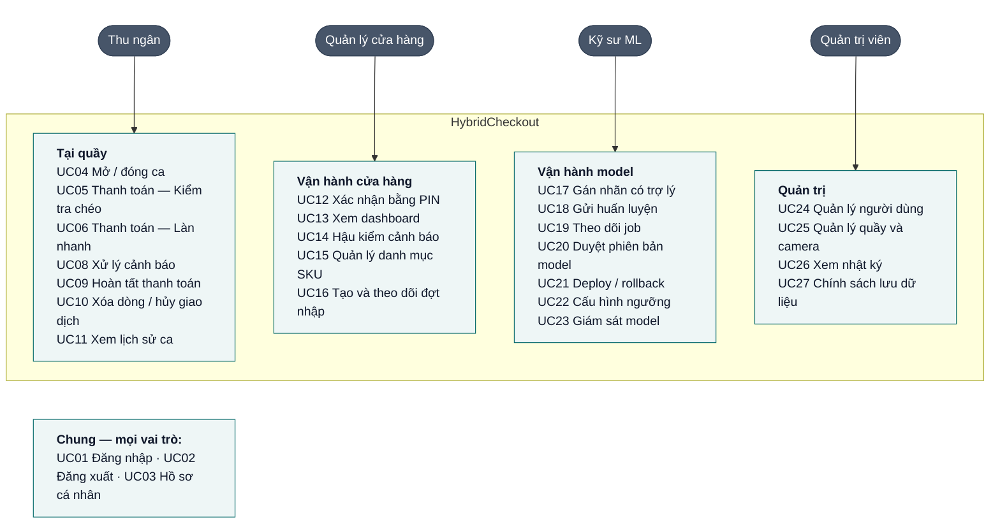
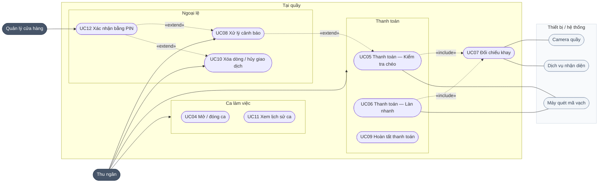
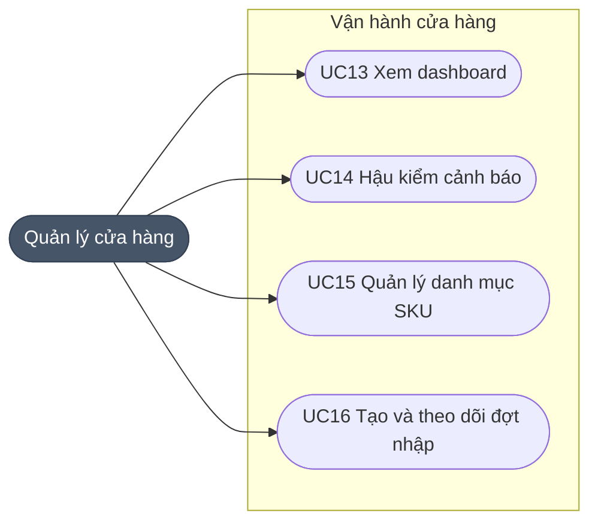
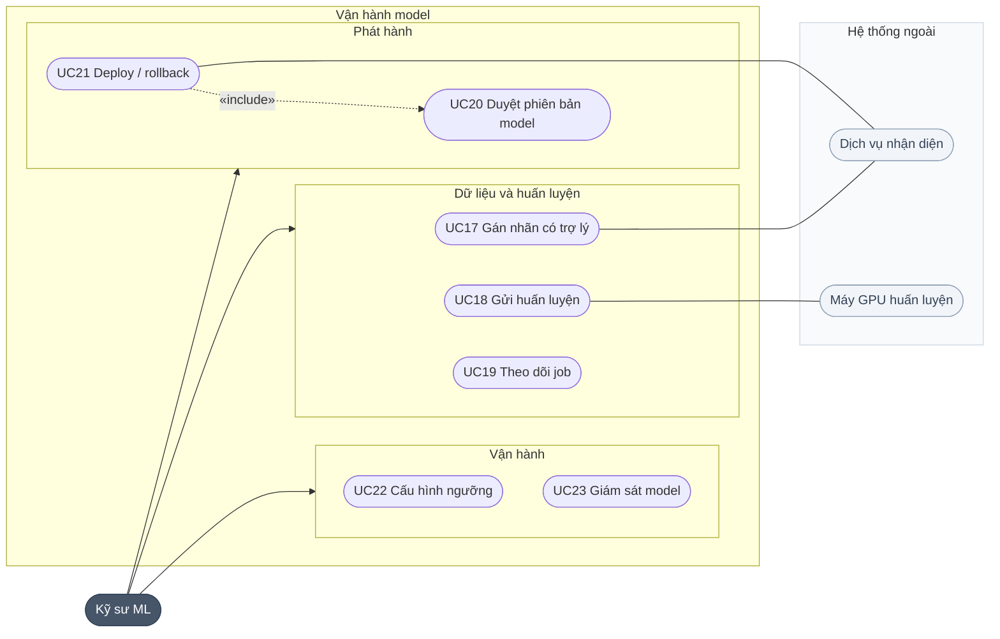
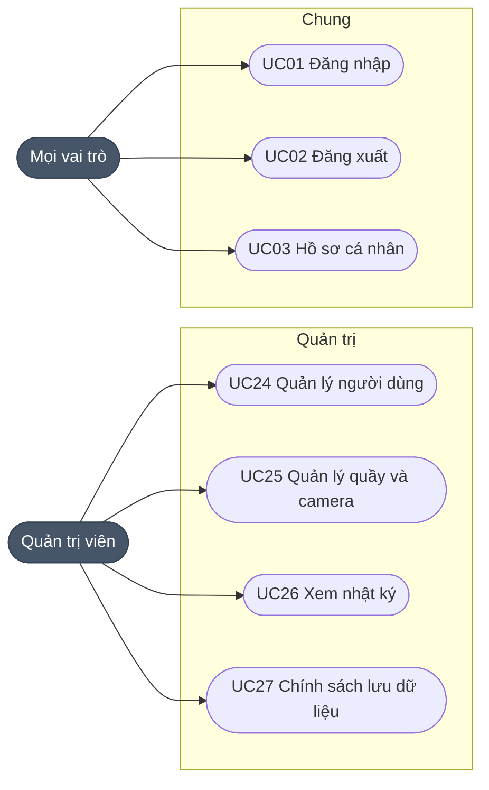

# Bước 2 — Use case và User story

## 1. Product mind map

Nguồn chỉnh sửa: [diagrams/mindmap.html](diagrams/mindmap.html). Nhãn **AI** đánh dấu 3 tính năng dùng model nhận diện.

## 2. Tác nhân

| Tác nhân | Loại | Vai trò trong hệ thống |
|---|---|---|
| Thu ngân | Chính | Bán hàng ở quầy, chế độ Kiểm tra chéo hoặc Làn nhanh |
| Quản lý cửa hàng | Chính | Xác nhận bằng PIN tại quầy; danh mục, đợt nhập, hậu kiểm |
| Kỹ sư ML | Chính | Gán nhãn, huấn luyện, duyệt và deploy model, chỉnh ngưỡng |
| Quản trị viên | Chính | Người dùng, quầy/camera, nhật ký, chính sách dữ liệu |
| Máy quét mã vạch | Thiết bị | Nhập mã vạch vào màn quầy |
| Camera quầy | Thiết bị | Chụp ảnh khay từ trên xuống |
| Dịch vụ nhận diện | Hệ thống | Chạy model trên ảnh khay, trả về box, SKU, độ tin cậy |
| Máy GPU huấn luyện | Hệ thống ngoài | Chạy job huấn luyện một đợt |

## 3. Sơ đồ use case

Sơ đồ 3.1 cho cái nhìn tổng quan. Các sơ đồ 3.2–3.5 vẽ chi tiết từng khu vực, kèm thiết bị và quan hệ «include» / «extend».

### 3.1 Tổng quan theo vai trò

### 3.2 Tại quầy

Thu ngân dùng mọi use case trong cụm "Thanh toán" và "Ca làm việc". UC07 do hệ thống thực hiện mỗi lần thanh toán.

### 3.3 Vận hành cửa hàng

### 3.4 Vận hành model

Đợt nhập do Quản lý tạo ở UC16 là đầu vào của UC17.

### 3.5 Quản trị và chức năng chung

## 4. Danh sách use case

| ID | Use case | Tác nhân | Mô tả |
|---|---|---|---|
| UC01 | Đăng nhập | Mọi vai trò | Vào hệ thống, chuyển tới trang mặc định của vai trò |
| UC02 | Đăng xuất | Mọi vai trò | Kết thúc phiên |
| UC03 | Hồ sơ cá nhân | Mọi vai trò | Sửa thông tin, đổi mật khẩu; quản lý đặt PIN |
| UC04 | Mở / đóng ca | Thu ngân | Chọn quầy, nhập tiền đầu ca; đóng ca có đối soát |
| UC05 | Thanh toán — Kiểm tra chéo | Thu ngân | Quét mã từng món rồi kiểm tra khay trước khi thanh toán |
| UC06 | Thanh toán — Làn nhanh | Thu ngân | Camera nhận diện cả khay, thu ngân quét món không chắc |
| UC07 | Đối chiếu khay | Hệ thống | So danh sách quét với kết quả nhận diện, sinh cảnh báo |
| UC08 | Xử lý cảnh báo | Thu ngân | Quét bổ sung hoặc yêu cầu quản lý |
| UC09 | Hoàn tất thanh toán | Thu ngân | Chọn phương thức, xuất hóa đơn |
| UC10 | Xóa dòng / hủy giao dịch | Thu ngân | Cần quản lý xác nhận |
| UC11 | Xem lịch sử ca | Thu ngân | Giao dịch trong ca của mình |
| UC12 | Xác nhận bằng PIN | Quản lý | Duyệt báo nhầm, xóa dòng, hủy giao dịch, bỏ qua kiểm tra |
| UC13 | Xem dashboard | Quản lý | Doanh thu, cảnh báo, thất thoát ngăn được, độ phủ SKU |
| UC14 | Hậu kiểm cảnh báo | Quản lý | Xem lại cảnh báo đã đóng, đánh giá đúng/sai/gian lận |
| UC15 | Quản lý danh mục SKU | Quản lý | Thêm, sửa giá, ngừng bán; xem trạng thái nhận diện |
| UC16 | Tạo và theo dõi đợt nhập | Quản lý | Gom SKU mới thành đợt, theo dõi đến khi deploy |
| UC17 | Gán nhãn có trợ lý | Kỹ sư ML | Duyệt box hàng cũ do model đề xuất, vẽ box hàng mới |
| UC18 | Gửi huấn luyện | Kỹ sư ML | Khi đợt đủ dữ liệu, tạo job huấn luyện |
| UC19 | Theo dõi job | Kỹ sư ML | Trạng thái, tiến độ, log, giờ GPU |
| UC20 | Duyệt phiên bản model | Kỹ sư ML | So với phiên bản đang chạy theo cổng duyệt |
| UC21 | Deploy / rollback | Kỹ sư ML | Đưa phiên bản mới ra quầy hoặc quay lại bản trước |
| UC22 | Cấu hình ngưỡng | Kỹ sư ML | Chỉnh ngưỡng cảnh báo, ngưỡng tự nhận; xem trước tác động |
| UC23 | Giám sát model | Kỹ sư ML | Báo nhầm, bản sửa, cặp hay nhầm, độ trễ |
| UC24 | Quản lý người dùng | Quản trị viên | Tạo, sửa, khóa tài khoản, gán vai trò |
| UC25 | Quản lý quầy và camera | Quản trị viên | Thêm quầy, gán camera, chụp thử |
| UC26 | Xem nhật ký | Quản trị viên | Thao tác quan trọng, chỉ đọc |
| UC27 | Chính sách lưu dữ liệu | Quản trị viên | Thời gian giữ ảnh giao dịch và ảnh đợt nhập |

## 5. Đặc tả use case chính

### UC05 — Thanh toán, chế độ Kiểm tra chéo
- **Tiền điều kiện:** đã mở ca; có model đang chạy.
- **Luồng chính:** quét mã từng món → bấm **Kiểm tra khay** → hệ thống chụp và đối chiếu (UC07) → không có cảnh báo Cao thì mở **Thanh toán** (UC09).
- **Rẽ nhánh:**
  - Có cảnh báo Cao → khóa thanh toán → UC08.
  - Camera lỗi → thử lại; sau 2 lần, quản lý có thể cho bỏ qua (UC12), giao dịch ghi "không kiểm tra".
  - Mã không có trong danh mục → báo lỗi, không thêm dòng.

### UC06 — Thanh toán, chế độ Làn nhanh
1. Bấm **Nhận diện khay**.
2. Món đã học và chắc chắn (độ tin ≥ ngưỡng tự nhận) tự vào giỏ. Món không chắc được đánh số, chờ quét.
3. Thu ngân quét từng món không chắc và **mọi món không có khung** (thường là hàng mới).
4. Tích "đã quét hết món ngoài vùng nhận diện" → đối chiếu (UC07) → thanh toán.

Nếu thu ngân quét mã khác với SKU model đoán, hệ thống ghi một **bản sửa** để giám sát model.

### UC07 — Đối chiếu khay
Đầu vào: số lượng đã quét theo SKU, kết quả nhận diện, danh sách SKU đã học, ngưỡng.

1. Chỉ đếm nhận diện có độ tin ≥ ngưỡng cảnh báo → số lượng camera thấy.
2. Với từng SKU **đã học**: so số camera thấy với số đã quét.
3. Một SKU **thừa** và một SKU **thiếu** cùng nhóm hàng → **Nghi tráo mã**. Mức Cao nếu món camera thấy đắt hơn, ngược lại mức Trung bình.
4. Có bao nhiêu món **hàng mới chưa học** đã quét thì bỏ qua bấy nhiêu món thừa (model có thể đoán hàng mới thành hàng cũ).
5. Món thừa còn lại → **Món chưa quét**, mức Cao.
6. Món thiếu còn lại → **Quét nhưng không thấy**, mức Thấp (có thể đã cho vào túi).
7. Nhận diện có độ tin giữa ngưỡng thấp và ngưỡng cảnh báo → chỉ vẽ khung nét đứt, không cảnh báo.

### UC08 — Xử lý cảnh báo
Chọn cảnh báo → ảnh làm nổi vùng liên quan → **Quét bổ sung** → đối chiếu chạy lại, cảnh báo tự đóng. Nếu cho là báo nhầm → **Yêu cầu quản lý** (UC12). Cảnh báo mức Thấp được bỏ qua.

### UC12 — Xác nhận bằng PIN
Quản lý chọn lý do, nhập PIN 6 số trên màn quầy. Hệ thống ghi người xác nhận, thời gian, lý do. Không chấp nhận PIN của chính người đang đứng quầy. Sai 3 lần thì khóa 5 phút.

### UC17 — Gán nhãn có trợ lý
- **Tiền điều kiện:** đợt nhập đang ở bước gán nhãn; có ảnh khay chứa hàng mới (lấy từ giao dịch có mã của hàng mới, hoặc chụp bổ sung).
- **Luồng chính:**
  1. Mở ảnh tiếp theo. Hệ thống hiện box **hàng cũ** do model đề xuất (nét đứt) và danh sách **hàng mới** trong khay theo mã vạch, kèm số lượng.
  2. Chấp nhận từng box đề xuất hoặc chấp nhận hàng loạt các box có độ tin ≥ 0,7; từ chối box sai.
  3. Chọn SKU mới, kéo chuột vẽ box cho từng món.
  4. Lưu. Nếu số box hàng mới khác số lượng theo mã vạch, hoặc còn đề xuất chưa duyệt, hệ thống hỏi lại trước khi lưu.
- **Rẽ nhánh:** ảnh mờ hoặc không có hàng mới → bỏ qua kèm lý do.

### UC20, UC21 — Duyệt và deploy model
Phiên bản mới (sau job huấn luyện) ở trạng thái **Chờ duyệt**. Trang phiên bản so sánh với bản đang chạy theo từng điều kiện cổng duyệt (BR-09).
- **Deploy:** xác nhận lần hai; nếu có điều kiện không đạt thì bắt buộc ghi lý do. Sau deploy, SKU của đợt chuyển **Đã học**.
- **Rollback:** quay về bản trước; SKU của đợt bị rollback quay về **Chưa học**.

## 6. Quy tắc nghiệp vụ

| ID | Quy tắc |
|---|---|
| BR-01 | Mã vạch quyết định hóa đơn; camera chỉ đề xuất hoặc cảnh báo |
| BR-02 | Camera chỉ kiểm tra / tự nhận SKU mà model đang chạy đã học; SKU khác bán bằng mã vạch |
| BR-03 | Còn cảnh báo mức Cao thì không thanh toán được |
| BR-04 | Thu ngân chỉ đóng cảnh báo Cao bằng quét bổ sung; đóng theo hướng "báo nhầm" cần PIN quản lý |
| BR-05 | Xóa dòng, hủy giao dịch, bỏ qua kiểm tra khay cần PIN quản lý |
| BR-06 | Mỗi giao dịch lưu: danh sách quét, giá lúc bán, ảnh khay, kết quả nhận diện, phiên bản model, cảnh báo và cách xử lý |
| BR-07 | Chỉ một phiên bản model chạy tại một thời điểm |
| BR-08 | Deploy phải qua cổng duyệt hoặc ghi lý do override; luôn rollback được về bản liền trước |
| BR-09 | Cổng duyệt: AP50 không giảm quá 1 điểm so với bản đang chạy · mức quên hàng cũ ≤ 5 điểm · bắt món sót ≥ 90% · báo nhầm khay sạch ≤ 10%. cAcc chỉ để tham khảo vì nó tự giảm khi số SKU tăng |
| BR-10 | Ngưỡng chỉnh theo nhóm đợt, chọn trên tập val, không chọn trên tập test |
| BR-11 | Chỉ gửi huấn luyện khi mỗi SKU mới có ≥ 20 box đã duyệt và tập val của đợt ≥ 50 ảnh |
| BR-12 | Box đề xuất của model chỉ thành nhãn khi được người chấp nhận |
| BR-13 | Ảnh giao dịch giữ 30 ngày; ảnh đợt nhập xóa sau khi deploy 14 ngày (cấu hình được) |
| BR-14 | Chỉ quản lý đổi giá và trạng thái bán; mã vạch không trùng |
| BR-15 | Phân quyền kiểm tra ở backend; ẩn nút trên giao diện chỉ để tiện dùng |

### Loại cảnh báo

| Cảnh báo | Mức | Chặn thanh toán | Cách đóng |
|---|---|---|---|
| Món chưa quét | Cao | Có | Quét bổ sung, hoặc quản lý xác nhận báo nhầm |
| Nghi tráo mã | Cao / Trung bình | Khi mức Cao | Xóa dòng sai và quét đúng, hoặc quản lý xác nhận |
| Quét nhưng camera không thấy | Thấp | Không | Tự đóng khi thanh toán |
| Không kiểm tra được khay | Trung bình | Có | Thử lại, hoặc quản lý cho bỏ qua |

## 7. Trạng thái

| Đối tượng | Vòng đời |
|---|---|
| Giao dịch | Đang quét → (Chờ xử lý cảnh báo) → Sẵn sàng thanh toán → Đã thanh toán; hoặc Đã hủy |
| Cảnh báo | Mở → Đã quét bổ sung / QL xác nhận báo nhầm / Tự đóng → (Đã hậu kiểm) |
| SKU | Chưa học → Đang học (thuộc đợt đang xử lý) → Đã học; rollback về Chưa học |
| Đợt nhập | Nháp → Gán nhãn → Huấn luyện → Chờ duyệt → Đã deploy |
| Job | Chờ → Đang chạy → Đang đánh giá → Xong / Lỗi |
| Phiên bản model | Chờ duyệt → Đang chạy → Đã thay thế; hoặc Bị từ chối |

## 8. Phân quyền

| Chức năng | Thu ngân | Quản lý | Kỹ sư ML | Quản trị viên |
|---|:-:|:-:|:-:|:-:|
| Bán hàng tại quầy, xử lý cảnh báo bằng quét bổ sung | ✓ | ✓ | | |
| Xác nhận bằng PIN | | ✓ | | |
| Lịch sử giao dịch | Ca của mình | Toàn cửa hàng | | |
| Dashboard, hậu kiểm | | ✓ | Xem | |
| Danh mục SKU | Tra cứu khi quét | ✓ | Xem | |
| Tạo đợt nhập | | ✓ | | |
| Gán nhãn, gửi huấn luyện | | | ✓ | |
| Job, phiên bản model, giám sát | | Xem | ✓ | |
| Deploy / rollback, ngưỡng | | | ✓ | |
| Người dùng, quầy/camera, lưu dữ liệu | | | | ✓ |
| Nhật ký | | Của cửa hàng | | ✓ |
| Hồ sơ cá nhân | ✓ | ✓ | ✓ | ✓ |

## 9. User story

### 9.1 Danh sách

| ID | Là… | Tôi muốn… | Để… | UC |
|---|---|---|---|---|
| US01 | Người dùng | đăng nhập | vào đúng khu vực theo quyền | UC01 |
| US02 | Người dùng | đăng xuất | người khác không dùng phiên của tôi | UC02 |
| US03 | Người dùng | sửa hồ sơ, đổi mật khẩu (quản lý: đặt PIN) | giữ tài khoản an toàn | UC03 |
| US04 | Thu ngân | mở ca tại một quầy | giao dịch được ghi đúng quầy, đúng người | UC04 |
| US05 | Thu ngân | quét mã và thấy giỏ cập nhật ngay | thao tác như POS quen thuộc | UC05 |
| US06 | Thu ngân | hệ thống kiểm tra khay trước khi thanh toán | biết ngay món nào chưa quét hoặc quét sai | UC05, UC07 |
| US07 | Thu ngân | xử lý cảnh báo bằng quét bổ sung | hoàn tất giao dịch nhanh | UC08 |
| US08 | Quản lý | xác nhận bằng PIN ngay tại quầy | không chặn khách lâu mà vẫn có người chịu trách nhiệm | UC12, UC10 |
| US09 | Thu ngân | camera đề xuất hóa đơn cho cả khay | phục vụ nhanh giờ cao điểm | UC06 |
| US10 | Thu ngân | biết món nào cần quét xác nhận | không bỏ sót ở làn nhanh | UC06 |
| US11 | Thu ngân | chọn phương thức thanh toán và xuất hóa đơn | kết thúc giao dịch | UC09 |
| US12 | Thu ngân | xem giao dịch trong ca và đóng ca | đối soát cuối ca | UC11, UC04 |
| US13 | Quản lý | xem dashboard | nắm doanh thu, cảnh báo, độ phủ SKU | UC13 |
| US14 | Quản lý | hậu kiểm cảnh báo đã đóng | phát hiện gian lận lặp lại | UC14 |
| US15 | Quản lý | quản lý SKU và thấy trạng thái nhận diện | danh mục luôn đúng | UC15 |
| US16 | Quản lý | tạo đợt nhập và theo dõi tiến độ | biết khi nào camera kiểm tra được hàng mới | UC16 |
| US17 | Kỹ sư ML | model đề xuất box hàng cũ, tôi chỉ vẽ hàng mới | gán nhãn một đợt nhanh hơn | UC17 |
| US18 | Kỹ sư ML | xem tiến độ dữ liệu từng SKU và gửi huấn luyện khi đủ | không huấn luyện với dữ liệu thiếu | UC18 |
| US19 | Kỹ sư ML | theo dõi trạng thái và log của job | biết job chạy đến đâu, lỗi gì | UC19 |
| US20 | Kỹ sư ML | so sánh phiên bản mới với bản đang chạy theo cổng duyệt | chỉ deploy model không kém hơn | UC20 |
| US21 | Kỹ sư ML | deploy hoặc rollback có xác nhận | cập nhật quầy an toàn | UC21 |
| US22 | Kỹ sư ML | chỉnh ngưỡng và xem trước tác động | cân bằng bắt sót và báo nhầm | UC22 |
| US23 | Kỹ sư ML | xem chất lượng model ngoài thực tế | biết khi nào cần cải thiện | UC23 |
| US24 | Quản trị viên | tạo, sửa, khóa tài khoản | kiểm soát truy cập | UC24 |
| US25 | Quản trị viên | quản lý quầy, camera, chụp thử | quầy luôn sẵn sàng | UC25 |
| US26 | Quản trị viên | xem nhật ký thao tác quan trọng | truy vết sự cố | UC26 |
| US27 | Quản trị viên | cấu hình thời gian lưu ảnh | tuân thủ chính sách dữ liệu | UC27 |

### 9.2 Tiêu chí chấp nhận

| Story | Tiêu chí chấp nhận |
|---|---|
| US01 | Đăng nhập đúng → về trang mặc định của vai trò · Sai → một thông báo chung · Tài khoản khóa không đăng nhập được |
| US02 | Đăng xuất xóa phiên, về trang đăng nhập |
| US03 | Đổi mật khẩu cần mật khẩu cũ, mật khẩu mới ≥ 8 ký tự · PIN 6 số, không hiện lại sau khi lưu · Không tự đổi vai trò |
| US04 | Mỗi quầy một ca mở · Màn quầy hiện trạng thái camera và phiên bản model |
| US05 | Quét mã đúng → thêm dòng (trùng SKU thì tăng số lượng) · Mã sai / ngừng bán → báo lỗi · SKU chưa học có nhãn "Camera chưa nhận diện" |
| US06 | Kết quả trong ≤ 3 giây (có GPU) · Đúng các cảnh báo theo UC07 · Không cảnh báo cho hàng mới chưa học đã quét · Box luôn có chữ, không chỉ dựa vào màu |
| US07 | Bấm cảnh báo → ảnh làm nổi vùng liên quan · Quét đúng SKU → cảnh báo tự đóng · Không có nút "Bỏ qua" cho cảnh báo Cao |
| US08 | PIN đúng + lý do → cảnh báo đóng, ghi người và thời gian · Sai 3 lần → khóa 5 phút · Từ chối PIN của người đang đứng quầy |
| US09 | Món đã học có độ tin ≥ ngưỡng tự nhận vào giỏ với nguồn "Camera" · Món không chắc hiện màu cam, có số thứ tự |
| US10 | Còn món cam thì không thanh toán · Quét mã khác SKU dự đoán → ghi bản sửa · Phải tích "đã quét hết món ngoài vùng" trước khi thanh toán |
| US11 | Tiền mặt: tính tiền thối, không xác nhận khi chưa đủ tiền · Sau thanh toán giao dịch không sửa được |
| US12 | Xem giao dịch trong ca kèm ảnh và cảnh báo · Đóng ca hiện chênh lệch tiền mặt |
| US13 | Lọc theo ngày, quầy · Có: doanh thu, giá trị món chưa quét đã phát hiện, tỉ lệ khay có cảnh báo, tỉ lệ báo nhầm, độ phủ SKU |
| US14 | Lọc theo loại, mức, cách xử lý, thu ngân · Đánh dấu: Cảnh báo đúng / Báo nhầm thật / Nghi gian lận · Thống kê theo thu ngân |
| US15 | Mã vạch không trùng, giá > 0 · SKU mới ở trạng thái Chưa học · Đổi giá không ảnh hưởng giao dịch cũ |
| US16 | Đợt gồm các SKU Chưa học · Tiến trình 5 bước có thời gian |
| US17 | Đề xuất nét đứt có độ tin · Nút chấp nhận hàng loạt ≥ 0,7 · Vẽ box bằng kéo chuột · Cảnh báo khi số box khác số lượng theo mã vạch · Thống kê % đề xuất được chấp nhận |
| US18 | Bảng box đã duyệt / mục tiêu theo SKU · Nút "Gửi huấn luyện" chỉ bật khi đạt BR-11 |
| US19 | Danh sách job: trạng thái, tiến độ, giờ GPU, thời gian · Xem log |
| US20 | Bảng điều kiện BR-09: giá trị mới, giá trị bản đang chạy, Đạt / Không đạt |
| US21 | Xác nhận lần hai; không đạt cổng thì bắt buộc ghi lý do · Sau deploy, SKU của đợt thành Đã học · Rollback đưa về Chưa học |
| US22 | Kéo ngưỡng → thấy ngay bắt sót, báo nhầm, % tự nhận · Lưu tạo cấu hình mới, hoàn tác được |
| US23 | Biểu đồ theo ngày: tỉ lệ cảnh báo, báo nhầm · Cặp SKU hay nhầm · Độ trễ |
| US24 | Email không trùng · Khóa/mở khóa · Không tự khóa chính mình |
| US25 | Thêm quầy, gán camera · "Chụp thử" hiện ảnh hoặc lỗi kết nối |
| US26 | Ghi: đăng nhập, PIN, xóa dòng, hủy, đổi giá, deploy/rollback, đổi ngưỡng, đổi quyền · Không sửa / xóa được |
| US27 | Cấu hình số ngày giữ ảnh · Hiện dung lượng đang dùng |

### 9.3 Đánh giá INVEST

| Tiêu chí | Cách đáp ứng |
|---|---|
| **I**ndependent | Mỗi story cho ra một kết quả demo được; chỉ phụ thuộc US01 và dữ liệu có sẵn |
| **N**egotiable | Bố cục giao diện đổi được; mục tiêu và quyền giữ nguyên |
| **V**aluable | Mỗi story ghi rõ giá trị ở cột "Để…" |
| **E**stimable | Đầu vào, đầu ra, vai trò và trường hợp lỗi đã nêu trong UC và tiêu chí |
| **S**mall | Mỗi story một chức năng. US17 lớn nhất, khi code tách thành 17a (duyệt đề xuất) và 17b (vẽ box) |
| **T**estable | Mọi story có tiêu chí chấp nhận quan sát được ở mục 9.2 |

Ràng buộc chung cho mọi story: phân quyền ở backend, thao tác nhạy cảm vào nhật ký, mọi màn có trạng thái đang tải / rỗng / lỗi.
