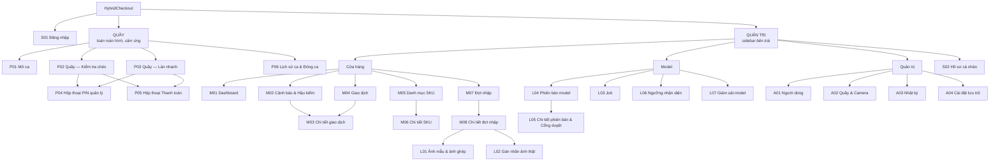

# Bước 3 — Kiến trúc thông tin

Mỗi màn hình được mô tả theo dạng sitemap: **màn hình → các section từ trên xuống → mỗi vai trò làm được gì**.

Ký hiệu: ✏️ thao tác · 👁 chỉ xem · — không thấy.
Vai trò: **TN** Thu ngân · **QL** Quản lý cửa hàng · **ML** Kỹ sư ML · **AD** Quản trị viên.

## 1. Sitemap

Mã màn hình: **S** chung · **P** quầy (POS) · **M** quản lý cửa hàng · **L** model (ML) · **A** quản trị.

## 2. Điều hướng theo vai trò

| Vai trò | Trang mặc định | Menu |
|---|---|---|
| Thu ngân | P01 Mở ca (P02 nếu đã có ca) | Không có sidebar. Thanh trên màn quầy có: Lịch sử ca, Đăng xuất |
| Quản lý | M01 Dashboard | **Cửa hàng:** Dashboard · Cảnh báo · Giao dịch · Danh mục SKU · Đợt nhập — **Model (xem):** Phiên bản · Giám sát — nút **Mở màn quầy** |
| Kỹ sư ML | L04 Phiên bản model | **Model:** Phiên bản · Job · Ngưỡng · Giám sát — **Dữ liệu:** Đợt nhập · Danh mục SKU · Dashboard |
| Quản trị viên | A01 Người dùng | Người dùng · Quầy & Camera · Nhật ký · Cài đặt lưu trữ |

Vào URL không có quyền → màn **Không có quyền**.

## 3. Thành phần dùng chung

| Thành phần | Có ở | Nội dung |
|---|---|---|
| Thanh trạng thái quầy | P01–P06 | Quầy · trạng thái camera · phiên bản model · thu ngân · giờ · Lịch sử ca · Đăng xuất |
| Sidebar + thanh trên | M, L, A, S02 | Menu theo vai trò · tên trang · model đang chạy · tài khoản |
| Ô xem ảnh khay | P02, P03, M03, L02 | Ảnh + box có nhãn chữ; bấm box để chọn; làm nổi box liên quan |
| Trạng thái trang | Mọi danh sách | Đang tải · Rỗng (kèm gợi ý) · Lỗi (kèm Thử lại) |

## 4. Màn hình chung

### S01 — Đăng nhập · `/login`
| Section | Nội dung | Mọi người |
|---|---|:-:|
| Giới thiệu | Tên sản phẩm, một câu mô tả, 3 tính năng chính | 👁 |
| Form | Email, mật khẩu (hiện/ẩn), Đăng nhập; lỗi chung khi sai | ✏️ |
| Tài khoản demo | Chỉ có trong prototype: vào nhanh theo vai trò | ✏️ |

### S02 — Hồ sơ cá nhân · `/profile`
| Section | Nội dung | TN | QL | ML | AD |
|---|---|:-:|:-:|:-:|:-:|
| Thông tin | Họ tên, email, vai trò (chỉ đọc) | 👁 | 👁 | 👁 | 👁 |
| Đổi mật khẩu | Mật khẩu cũ, mới, xác nhận | ✏️ | ✏️ | ✏️ | ✏️ |
| PIN quản lý | Đặt / đổi PIN 6 số | — | ✏️ | — | — |

## 5. Khu vực Quầy

### P01 — Mở ca · `/pos/open-shift`
| Section | Nội dung | TN | QL |
|---|---|:-:|:-:|
| Chọn quầy | Danh sách quầy và trạng thái camera | ✏️ | ✏️ |
| Tiền đầu ca | Nhập tiền mặt đầu ca | ✏️ | ✏️ |
| Kiểm tra trước ca | Ảnh chụp thử, model đang chạy, số SKU camera nhận diện được | 👁 | 👁 |

### P02 — Quầy, chế độ Kiểm tra chéo · `/pos`
Bố cục 2 cột: trái là ảnh khay, phải là các bước thao tác từ trên xuống.

| Section | Nội dung | TN | QL |
|---|---|:-:|:-:|
| Chọn chế độ + các bước | Kiểm tra chéo / Làn nhanh (chỉ đổi khi giỏ trống); thanh 3 bước: Quét mã → Kiểm tra khay → Thanh toán | ✏️ | ✏️ |
| Ô mã vạch | Luôn giữ con trỏ cho máy quét; báo lỗi mã không có / ngừng bán | ✏️ | ✏️ |
| Ảnh khay | Trước khi kiểm tra: hướng dẫn. Sau khi kiểm tra: box xanh (khớp), đỏ (cảnh báo), xám nét đứt (không chắc) | 👁 | 👁 |
| Nút Kiểm tra khay | Chụp và đối chiếu; đang xử lý; lỗi + thử lại; sau 2 lỗi: bỏ qua (cần PIN) | ✏️ | ✏️ |
| Cảnh báo | Thẻ theo mức; bấm để làm nổi trên ảnh; **Quét bổ sung** / **Yêu cầu quản lý**; mức Thấp có **Bỏ qua** | ✏️ | ✏️ |
| Giỏ hàng | Tên, mã, số lượng, đơn giá; nhãn "Camera chưa nhận diện" cho hàng mới; xóa dòng (cần PIN) | ✏️ | ✏️ |
| Tổng tiền | Tổng; **Thanh toán** (khóa kèm lý do); **Hủy giao dịch** (cần PIN) | ✏️ | ✏️ |

### P03 — Quầy, chế độ Làn nhanh · `/pos`
Cùng bố cục với P02, thứ tự ngược lại: nhận diện trước, quét sau.

| Section | Nội dung | TN | QL |
|---|---|:-:|:-:|
| Chọn chế độ + các bước | Thanh 3 bước: Nhận diện khay → Quét món cần xác nhận → Thanh toán | ✏️ | ✏️ |
| Ảnh khay | Box xanh = tự nhận; cam có số = cần quét | 👁 | 👁 |
| Cần quét xác nhận | Danh sách món cam; nhắc quét cả món **không có khung**; ô tích "đã quét hết món ngoài vùng" | ✏️ | ✏️ |
| Ô mã vạch | Quét món đang chọn; mã khác dự đoán → ghi bản sửa | ✏️ | ✏️ |
| Giỏ hàng | Mỗi dòng ghi nguồn **Camera** hoặc **Mã vạch** | ✏️ | ✏️ |
| Tổng tiền | Như P02; Thanh toán khóa khi còn món cam hoặc chưa tích xác nhận | ✏️ | ✏️ |

### P04 — Hộp thoại PIN quản lý
| Section | Nội dung | Người nhập: QL |
|---|---|:-:|
| Việc cần xác nhận | Báo nhầm / xóa dòng / hủy giao dịch / bỏ qua kiểm tra, kèm tóm tắt | 👁 |
| Lý do | Chọn lý do có sẵn + ghi chú | ✏️ |
| Bàn phím PIN | 6 số; báo sai, đếm số lần sai | ✏️ |

### P05 — Hộp thoại Thanh toán
| Section | Nội dung | TN | QL |
|---|---|:-:|:-:|
| Tổng kết | Số món, tổng tiền, số cảnh báo đã xử lý | 👁 | 👁 |
| Phương thức | Tiền mặt / Thẻ / Chuyển khoản (giả lập); tiền mặt có tiền khách đưa, mệnh giá nhanh, tiền thối | ✏️ | ✏️ |
| Hóa đơn | Mã giao dịch, các dòng, tổng; In; Giao dịch mới | ✏️ | ✏️ |

### P06 — Lịch sử ca & Đóng ca · `/pos/shift`
| Section | Nội dung | TN | QL |
|---|---|:-:|:-:|
| Tổng kết ca | Số giao dịch, doanh thu, cảnh báo theo cách xử lý | 👁 | 👁 |
| Giao dịch trong ca | Bảng; bấm xem ảnh, dòng, cảnh báo | 👁 | 👁 |
| Đóng ca | Tiền mặt thực đếm, chênh lệch, Đóng ca | ✏️ | ✏️ |

## 6. Khu vực Quản trị — Cửa hàng

### M01 — Dashboard · `/dashboard`
| Section | Nội dung | QL | ML |
|---|---|:-:|:-:|
| Bộ lọc | Hôm nay / 7 ngày / 30 ngày; quầy | ✏️ | ✏️ |
| Thẻ chỉ số | Doanh thu · Giá trị món chưa quét đã phát hiện · Khay có cảnh báo · Tỉ lệ báo nhầm · Độ phủ SKU | 👁 | 👁 |
| Biểu đồ | Cảnh báo theo ngày, theo loại | 👁 | 👁 |
| Model & đợt nhập | Model đang chạy; đợt nhập đang xử lý và tiến độ | 👁 | 👁 |
| Chờ hậu kiểm | 5 cảnh báo bị xác nhận báo nhầm gần nhất → M03 | ✏️ | 👁 |

### M02 — Cảnh báo & Hậu kiểm · `/alerts`
| Section | Nội dung | QL | ML |
|---|---|:-:|:-:|
| Thẻ tóm tắt | Tổng · Đã quét bổ sung · QL xác nhận báo nhầm · Chờ hậu kiểm | 👁 | 👁 |
| Bộ lọc + bảng | Lọc loại, mức, cách xử lý, thu ngân; bấm dòng → M03 | ✏️ | 👁 |
| Theo thu ngân | Tỉ lệ báo nhầm được xác nhận; đánh dấu bất thường | 👁 | — |
| Nhật ký | Nút mở A03 (nhật ký của cửa hàng) | ✏️ | — |

### M03 — Chi tiết giao dịch · `/transactions/:id`
| Section | Nội dung | QL | ML |
|---|---|:-:|:-:|
| Thông tin | Thời gian, quầy, thu ngân, chế độ, model, tổng | 👁 | 👁 |
| Ảnh khay | Box nhận diện và box gây cảnh báo | 👁 | 👁 |
| Cảnh báo | Cách xử lý, người xác nhận, lý do; **Hậu kiểm**: Cảnh báo đúng / Báo nhầm thật / Nghi gian lận | ✏️ | 👁 |
| Đối chiếu theo SKU | Đã quét · Camera thấy · Chênh | 👁 | 👁 |
| Gửi vào hàng đợi ảnh khó | Ảnh khay vào hàng đợi gán nhãn của đợt tới (L02) | ✏️ | ✏️ |

### M04 — Giao dịch · `/transactions`
| Section | Nội dung | QL |
|---|---|:-:|
| Bộ lọc + bảng | Quầy, chế độ, chỉ giao dịch có cảnh báo; bấm → M03 | ✏️ |

### M05 — Danh mục SKU · `/skus`
| Section | Nội dung | QL | ML |
|---|---|:-:|:-:|
| Thẻ tóm tắt | Đang bán · Đã học · Đang học · Chưa học | 👁 | 👁 |
| Bộ lọc + bảng | Tìm tên/mã; nhóm hàng; trạng thái học. Cột: tên, mã vạch, nhóm, giá, **trạng thái học**, đợt, bán | ✏️ | 👁 |
| Hành động | Thêm SKU, nhập CSV | ✏️ | — |

### M06 — Chi tiết SKU · `/skus/:id`
| Section | Nội dung | QL | ML |
|---|---|:-:|:-:|
| Thông tin | Nhóm, giá (sửa được), trạng thái bán | ✏️ | 👁 |
| Nhận diện | Trạng thái học, đợt, SKU hay bị nhầm với | 👁 | 👁 |
| Ảnh mẫu | Ảnh cắt nền đã nhận của SKU | 👁 | 👁 |

### M07 — Đợt nhập · `/batches`
| Section | Nội dung | QL | ML |
|---|---|:-:|:-:|
| Bảng đợt | Tên, số SKU, trạng thái, ngày tạo, ngày deploy | 👁 | 👁 |
| Tạo đợt | Chọn các SKU Chưa học | ✏️ | — |

### M08 — Chi tiết đợt nhập · `/batches/:id`
| Section | Nội dung | QL | ML |
|---|---|:-:|:-:|
| Tiến trình | Tạo đợt → Thu thập dữ liệu → Huấn luyện → Chờ duyệt → Đã deploy | 👁 | 👁 |
| Thẻ chỉ số | SKU đủ ảnh mẫu · số ảnh ghép · số ảnh tập kiểm tra | 👁 | 👁 |
| Dữ liệu theo SKU | Ảnh mẫu đã nhận / mục tiêu · box trong tập kiểm tra / mục tiêu | 👁 | 👁 |
| 1. Ảnh mẫu → ảnh ghép | Điều kiện đã đạt; **Mở ảnh mẫu** → L01 | ✏️ | ✏️ |
| 2. Ảnh thật → tập kiểm tra | Tiến độ hàng đợi; **Gán nhãn ảnh thật** → L02 | 👁 | ✏️ |
| Gửi huấn luyện | Bật khi đạt BR-11; tùy chọn trộn ảnh thật vượt mức (BR-16) | — | ✏️ |
| Job & phiên bản | Job của đợt, phiên bản sinh ra → L05 | 👁 | 👁 |

## 7. Khu vực Quản trị — Model

### L01 — Ảnh mẫu & ảnh ghép · `/batches/:id/samples`
Bố cục 3 cột: danh sách SKU mới · ảnh cắt của SKU đang chọn · ảnh ghép.

| Section | Nội dung | QL | ML |
|---|---|:-:|:-:|
| Thanh trên | Số SKU đủ ảnh mẫu | 👁 | 👁 |
| SKU mới | Mỗi SKU: ảnh đã nhận / mục tiêu; chọn để xem | ✏️ | ✏️ |
| Ảnh cắt | Hướng dẫn chụp; **Tải ảnh mẫu**; lưới ảnh đã cắt nền: Chờ duyệt / Cần xem kỹ / Nhận / Loại; **Nhận ảnh rõ** | ✏️ tải | ✏️ |
| Ảnh ghép | **Tạo ảnh ghép** (bật khi mọi SKU đủ ảnh); số ảnh đã tạo; ví dụ ảnh ghép; ghi chú ảnh ghép chỉ để huấn luyện | 👁 | ✏️ |

### L02 — Gán nhãn ảnh thật · `/batches/:id/label`
Bố cục 3 cột: hàng mới cần vẽ · ảnh · danh sách box. Ảnh lưu xong vào tập kiểm tra của đợt.

| Section | Nội dung | ML |
|---|---|:-:|
| Thanh trên | Ảnh x/y; nguồn ảnh (giao dịch có hàng mới / ảnh khó); Bỏ qua ảnh; **Lưu & ảnh tiếp** | ✏️ |
| Hàng mới cần vẽ | SKU mới trong khay theo mã vạch, số đã vẽ / cần vẽ; chọn để vẽ | ✏️ |
| Ảnh | Đề xuất hàng cũ (nét đứt) · đã chấp nhận (nét liền) · vẽ tay (tím). Kéo chuột để vẽ | ✏️ |
| Danh sách box | Chấp nhận / từ chối từng box; **Chấp nhận ≥ 0,7**; "Cần xem kỹ" cho đề xuất độ tin thấp; "Thay bằng box vẽ" cho đề xuất nằm dưới box vẽ tay | ✏️ |
| Phím tắt & thống kê | `1–9` chọn SKU · `A` chấp nhận · `Del` xóa · `Enter` lưu; % đề xuất được chấp nhận | 👁 |

### L03 — Job · `/jobs`
| Section | Nội dung | ML |
|---|---|:-:|
| Bảng job | Loại, đợt, trạng thái, tiến độ, giờ GPU, thời gian | 👁 |
| Chi tiết | Log; Hủy / Chạy lại | ✏️ |

### L04 — Phiên bản model · `/models`
| Section | Nội dung | ML | QL |
|---|---|:-:|:-:|
| Thẻ chỉ số | Phiên bản đang chạy, số SKU, AP50, cAcc | 👁 | 👁 |
| Biểu đồ | AP50 và cAcc qua các phiên bản, kèm giải thích | 👁 | 👁 |
| Dòng thời gian + bảng | Mọi phiên bản, trạng thái, kết quả cổng duyệt → L05 | 👁 | 👁 |

### L05 — Chi tiết phiên bản & Cổng duyệt · `/models/:id`
| Section | Nội dung | ML | QL |
|---|---|:-:|:-:|
| Cổng duyệt | Từng điều kiện: giá trị mới · bản đang chạy · Đạt / Không đạt | 👁 | 👁 |
| Thông tin | Đợt, số SKU, cAcc, giờ GPU, job | 👁 | 👁 |
| Cặp hay nhầm | Top cặp SKU nhầm trên val | 👁 | 👁 |
| Hành động | **Deploy** (xác nhận; ghi lý do nếu không đạt) · **Từ chối** · **Rollback** | ✏️ | — |

### L06 — Ngưỡng nhận diện · `/thresholds`
| Section | Nội dung | ML |
|---|---|:-:|
| Chỉnh ngưỡng | Theo nhóm đợt: ngưỡng cảnh báo, tự nhận, thấp | ✏️ |
| Xem trước | Bắt món sót · báo nhầm · % tự nhận, tính lại ngay | 👁 |
| Lịch sử | Các lần đổi; Hoàn tác | ✏️ |

### L07 — Giám sát model · `/monitoring`
| Section | Nội dung | ML | QL |
|---|---|:-:|:-:|
| Thẻ chỉ số | Độ trễ, khay có cảnh báo, báo nhầm, % tự nhận | 👁 | 👁 |
| Biểu đồ + cặp hay nhầm | Theo ngày; top cặp nhầm | 👁 | 👁 |
| Gợi ý | Việc nên làm cho đợt sau | 👁 | — |

## 8. Khu vực Quản trị — Hệ thống

| Màn hình | Section | AD |
|---|---|:-:|
| A01 Người dùng `/admin/users` | Thẻ theo vai trò · bảng người dùng · Thêm / Sửa / Khóa / Đặt lại mật khẩu | ✏️ |
| A02 Quầy & Camera `/admin/counters` | Bảng quầy, camera, kết nối · Thêm quầy · **Chụp thử** | ✏️ |
| A03 Nhật ký `/admin/audit` | Lọc theo người, thao tác · bảng chỉ đọc (QL xem nhật ký cửa hàng mình) | 👁 |
| A04 Cài đặt lưu trữ `/admin/settings` | Số ngày giữ ảnh · dung lượng · giá trị cổng duyệt mặc định | ✏️ |

## 9. Ma trận quyền theo màn hình

| Màn hình | TN | QL | ML | AD |
|---|:-:|:-:|:-:|:-:|
| S01, S02 | ✏️ | ✏️ | ✏️ | ✏️ |
| P01–P06 | ✏️ | ✏️ | — | — |
| M01 Dashboard, M02 Cảnh báo, M03 Chi tiết giao dịch | — | ✏️ | 👁 | — |
| M04 Giao dịch | — | 👁 | — | — |
| M05, M06 SKU | — | ✏️ | 👁 | — |
| M07, M08 Đợt nhập | — | ✏️ | ✏️ | — |
| L01 Ảnh mẫu | — | ✏️ (tải ảnh) | ✏️ | — |
| L02 Gán nhãn, L03 Job, L06 Ngưỡng | — | — | ✏️ | — |
| L04, L05 Phiên bản, L07 Giám sát | — | 👁 | ✏️ | — |
| A01, A02, A04 | — | — | — | ✏️ |
| A03 Nhật ký | — | 👁 | — | 👁 |

## 10. User story → màn hình

| Story | Màn hình | Story | Màn hình |
|---|---|---|---|
| US01–US03 | S01, S02 | US16, US19 | M07, M08 |
| US04, US12 | P01, P06 | US17 | L01 |
| US05–US08 | P02, P04 | US18 | L02 |
| US09, US10 | P03 | US20 | L03 |
| US11 | P05 | US21, US22 | L04, L05 |
| US13 | M01 | US23 | L06 |
| US14 | M02, M03 | US24 | L07 |
| US15 | M05, M06 | US25–US28 | A01–A04 |
