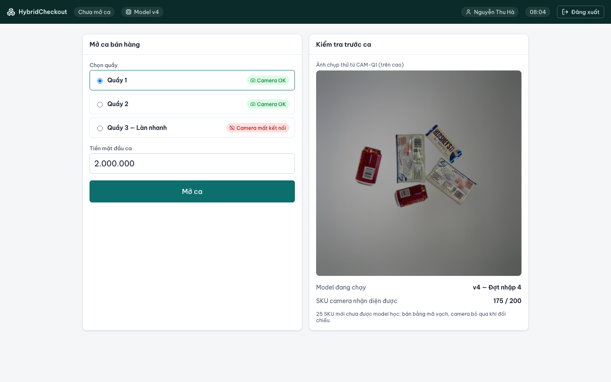
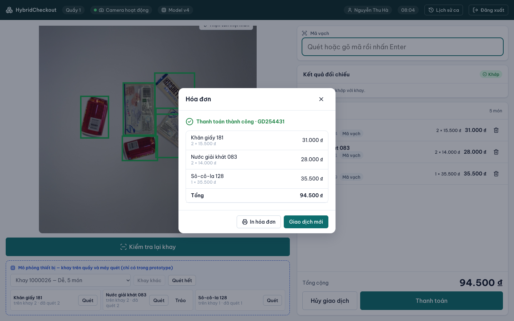
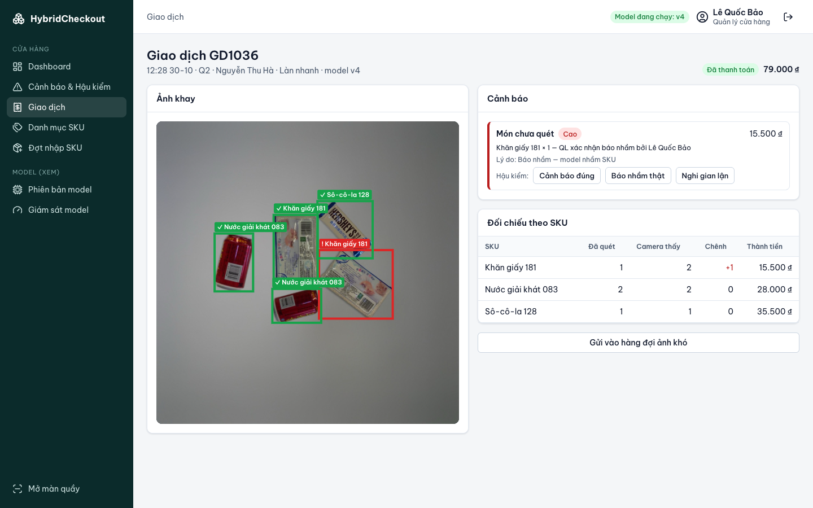
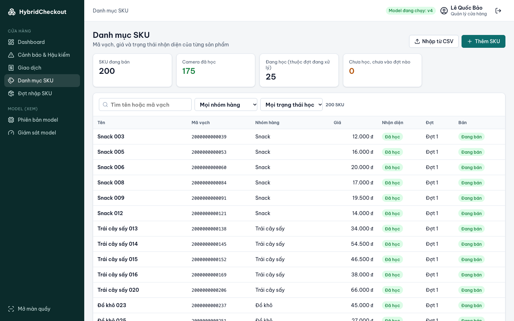
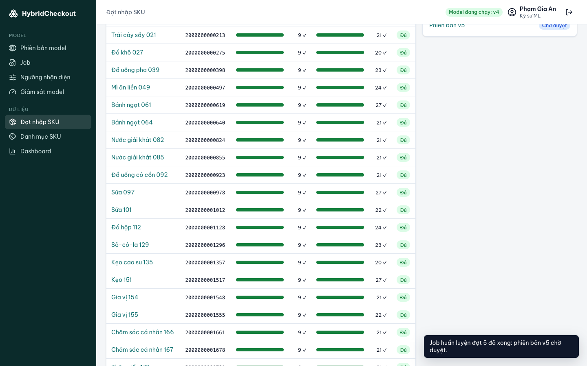
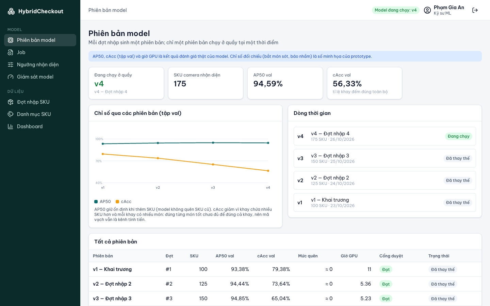
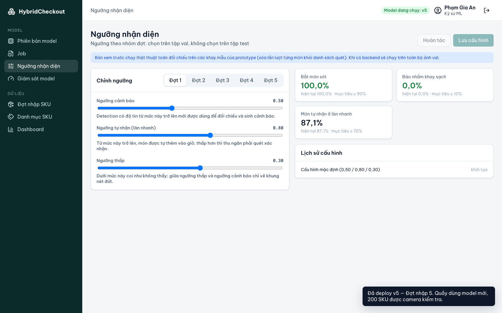
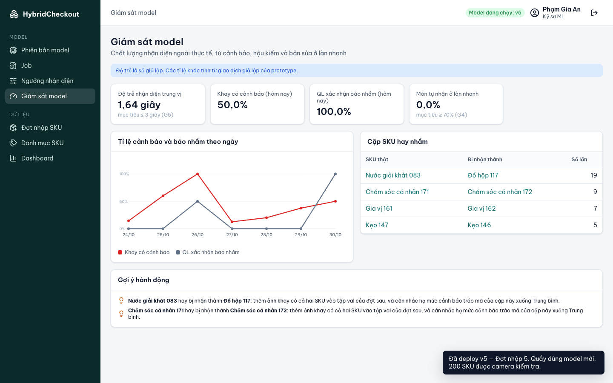
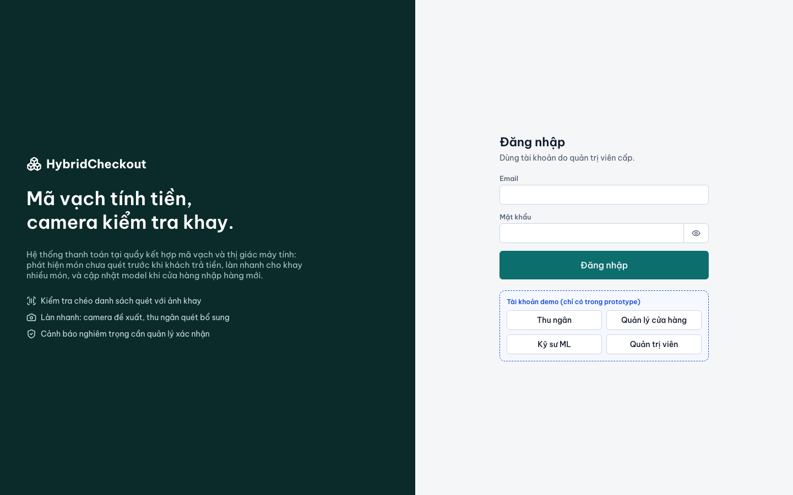
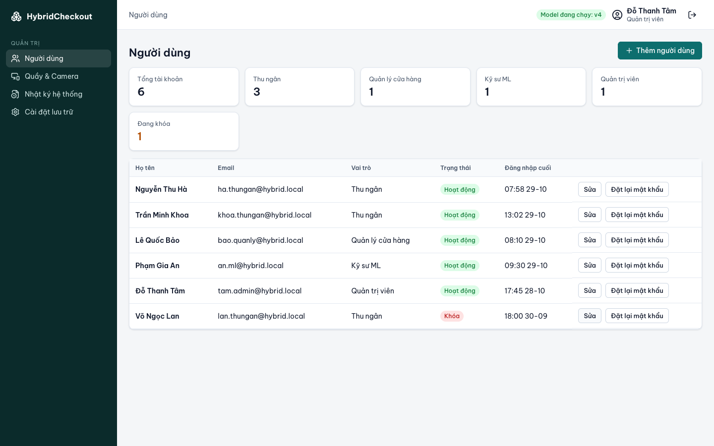

# Bước 4 — UI/UX

Prototype chạy được ở [`frontend/`](../frontend/): React + TypeScript + Vite, dữ liệu giả lập, đủ 27 màn hình và hộp thoại của [IA](03-information-architecture.md).

## 1. Nguyên tắc thiết kế

| # | Nguyên tắc | Áp dụng |
|---|---|---|
| 1 | Bước tiếp theo luôn rõ ràng | Màn quầy có thanh 3 bước; nút bị khóa luôn kèm một dòng giải thích lý do |
| 2 | Mã vạch trước, camera hỗ trợ | Ô mã vạch luôn giữ con trỏ cho máy quét; camera là nút riêng, không chặn việc quét |
| 3 | Cảnh báo trước khi trả tiền | Cảnh báo mức Cao khóa nút Thanh toán |
| 4 | Một cảnh báo, một hành động chính | Nút chính là **Quét bổ sung**; "báo nhầm" là nút phụ và cần PIN quản lý |
| 5 | Ảnh khay ít rối | Box khớp chỉ có viền xanh; chỉ box cần chú ý mới hiện tên. Có nút "Hiện tên mọi món" |
| 6 | Không chỉ dựa vào màu | Box có ký hiệu ✓ ! ? ✎ và chữ; trạng thái có huy hiệu chữ |
| 7 | Cảm ứng ở quầy | Nút chính cao 52 px; bàn phím PIN số lớn |
| 8 | Phân biệt AI và con người | Giỏ hàng ghi nguồn **Camera** hoặc **Mã vạch**; đề xuất của model nét đứt, box người vẽ nét liền |

Tham khảo: hướng dẫn thiết kế POS (màn ít rối, nút lớn, bước tiếp theo rõ, xử lý ngoại lệ mượt) [1][2]; công cụ gán nhãn CVAT và Label Studio (đề xuất của model để người duyệt, phím tắt) [3][4].

## 2. Bố cục

| | Khu vực Quầy | Khu vực Quản trị |
|---|---|---|
| Người dùng | Thu ngân, Quản lý | Quản lý, Kỹ sư ML, Quản trị viên |
| Thiết bị | Màn cảm ứng ngang ≥ 1366×768 + máy quét | Máy tính ≥ 1280 px |
| Bố cục | Thanh trạng thái tối; trái là ảnh khay, phải là mã vạch → cảnh báo → giỏ hàng → thanh toán | Sidebar tối, thanh trên, thẻ và bảng |

## 3. Design tokens

Định nghĩa bằng biến CSS trong [global.css](../frontend/src/styles/global.css).

| Token | Giá trị | Dùng cho |
|---|---|---|
| `--primary` | `#0d6e6e` | Nút chính, mục đang chọn |
| `--ok` / `--warn` / `--danger` / `--info` | `#15803d` / `#b45309` / `#b91c1c` / `#1d4ed8` | Đạt, Đã học · Cần chú ý · Cảnh báo Cao, lỗi · Ghi chú prototype |
| `--text` / `--text-2` / `--text-3` | `#0f172a` / `#475569` / `#94a3b8` | Chữ chính / phụ / mờ |
| Nền khung | `#0b2b2b` | Sidebar, thanh quầy |

| Box trên ảnh | Màu | Kiểu |
|---|---|---|
| Khớp / tự nhận | Xanh lá | Viền liền, tên ẩn mặc định |
| Gây cảnh báo | Đỏ | Viền liền, luôn có tên |
| Cần quét (làn nhanh) | Cam | Viền liền, có số thứ tự |
| Không chắc / có thể là hàng mới | Xám | Nét đứt |
| Đề xuất của model khi gán nhãn | Xanh dương | Nét đứt (chờ), liền (đã chấp nhận) |
| Box người vẽ | Tím | Viền liền |

Font **Be Vietnam Pro** (dấu tiếng Việt rõ); số tiền dùng `tabular-nums` cho thẳng cột.

## 4. Luồng chính

**Kiểm tra chéo:** Quét mã → Kiểm tra khay → (có cảnh báo: Quét bổ sung, hoặc PIN quản lý) → Thanh toán.

**Làn nhanh:** Nhận diện khay → món xanh tự vào giỏ → quét món cam và món không có khung → tích "đã quét hết" → Thanh toán.

**Trợ lý gán nhãn:** Quản lý tạo đợt → song song hai nhánh: *ảnh mẫu → duyệt ảnh cắt → tạo ảnh ghép* (dữ liệu huấn luyện) và *ảnh thật → duyệt đề xuất, vẽ hàng mới* (tập kiểm tra) → Gửi huấn luyện → cổng duyệt đo trên ảnh thật → Deploy → quầy nhận diện được hàng mới.

## 5. Màn hình

### Quầy — Kiểm tra chéo
Khay 5 món, quét sót 1 thanh sô-cô-la. Thanh bước đang ở "Kiểm tra khay"; ảnh đóng khung đỏ đúng món đó; dòng dưới tổng tiền nói vì sao chưa thanh toán được.


Tráo mã: quét gói khăn giấy rẻ cho gói đắt hơn cùng nhóm → **Nghi tráo mã**, mức Cao.


Báo nhầm cần PIN quản lý và lý do; thu ngân không tự đóng được.


### Quầy — Làn nhanh
Món chắc chắn tự vào giỏ (nguồn **Camera**); món không chắc có số thứ tự và nằm trong danh sách cần quét. Món 1 là hàng mới bị model đoán thành hàng cũ cùng nhóm, đúng hành vi khi gặp SKU chưa học.


### Mở ca, Hóa đơn



### Dashboard, Cảnh báo, Giao dịch, SKU





### Đợt nhập và Trợ lý gán nhãn
Chi tiết đợt có tiến trình 5 bước, tiến độ từng SKU theo hai loại dữ liệu và hai thẻ việc cần làm; **Gửi huấn luyện** chỉ bật khi đủ.


Ảnh mẫu: lưới ảnh đã cắt nền của từng SKU mới, nhận hoặc loại; đủ ảnh thì **Tạo ảnh ghép**.


Gán nhãn ảnh thật, 3 cột: hàng mới cần vẽ (theo mã vạch) · ảnh · danh sách box. Đề xuất độ tin thấp gắn "Cần xem kỹ"; đề xuất nằm dưới box vẽ tay tự thành "Thay bằng box vẽ".




### Phiên bản model, Cổng duyệt, Ngưỡng, Giám sát





### Đăng nhập, Quản trị



## 6. Trạng thái giao diện

| Trạng thái | Cách hiển thị |
|---|---|
| Đang tải | Biểu tượng xoay + chữ "Đang chụp và nhận diện…" |
| Rỗng | Biểu tượng + câu giải thích + gợi ý việc tiếp theo |
| Lỗi | Thông báo đỏ tại chỗ + thử lại; camera lỗi 2 lần thì có "Bỏ qua kiểm tra (cần QL)" |
| Bị khóa | Nút mờ + dòng lý do ngay cạnh |
| Cần xác nhận | Hộp thoại xác nhận lần hai (deploy, rollback, hủy giao dịch) |
| Thành công | Thông báo nổi góc dưới phải |

## 7. Khả năng tiếp cận

- Tương phản chữ đạt mức AA; mọi ô nhập có nhãn; nút chỉ có biểu tượng có `aria-label`.
- Hộp thoại `role="dialog"`; lỗi và thông báo dùng `role="alert"` / `aria-live`; chọn chế độ dùng `role="tab"`.
- Bàn phím: ô mã vạch nhận Enter; màn gán nhãn có `1–9`, `A`, `Del`, `Enter`.
- Dưới 1100 px: màn quầy về một cột, sidebar thành thanh ngang. Chưa tối ưu điện thoại (ngoài phạm vi).

## 8. Chạy prototype

```bash
python3 scripts/prepare_samples.py --model-repo <đường dẫn repo model>   # chép ảnh khay mẫu
cd frontend
npm install
npm run dev      # http://localhost:5173
npm test         # unit test thuật toán đối chiếu
npm run lint
```

Giới hạn:
- Dữ liệu nằm trong bộ nhớ trình duyệt: **tải lại trang (F5) là mất trạng thái**. Chuyển trang bằng menu thì giữ nguyên.
- Ảnh khay là **ảnh ghép** từ bộ mẫu của model (có sẵn box), dùng thay cho ảnh camera, kể cả ở màn gán nhãn ảnh thật. Ảnh mẫu của SKU là ảnh cắt từ chính các ảnh ghép đó.
- Nhận diện là mô phỏng: dùng box có sẵn của ảnh; hàng chưa học bị bỏ sót hoặc bị đoán thành hàng cũ cùng nhóm, giống model thật.
- Huấn luyện mô phỏng khoảng 10 giây; số liệu AP50, cAcc của các phiên bản là kết quả đánh giá thật của model.
- PIN quản lý demo: `246810`.

## 9. Kịch bản demo (5 phút)

1. **Thu ngân** → Mở ca Quầy 1. Model v4 nhận diện 175/200 SKU.
2. **Kiểm tra chéo:** quét thiếu 1 món → Kiểm tra khay → cảnh báo đỏ → Quét món đó → Thanh toán.
3. **Tráo mã:** bấm "Tráo" ở một món → Kiểm tra khay → Yêu cầu quản lý → nhập PIN.
4. **Làn nhanh:** chọn khay "có hàng mới" → Nhận diện → quét các món cam → Thanh toán.
5. **Kỹ sư ML** → Đợt nhập → Đợt 5 → **Mở ảnh mẫu** → nhận ảnh cho 5 SKU còn thiếu → **Tạo ảnh ghép** → về đợt → **Gán nhãn ảnh thật** → chấp nhận đề xuất, vẽ hàng mới (hoặc "Điền box mẫu") → lưu 4 ảnh.
6. **Gửi huấn luyện** → đợi job xong → Phiên bản model → v5 → **Deploy**.
7. **Thu ngân** → Làn nhanh với khay đó: hàng mới giờ được tự nhận.

## 10. Màn hình → mã nguồn

| Màn hình | File |
|---|---|
| S01–S03 | `features/auth/*` |
| P01–P06 | `features/pos/*` — logic ở `useCheckout.ts`, giao diện chia trong `components/` |
| M01–M08 | `features/store/*` |
| L01–L07 | `features/ml/*` |
| A01–A04 | `features/admin/*` |
| Đối chiếu khay (UC07) | `lib/reconcile.ts` + `lib/reconcile.test.ts` |

## Nguồn

1. Creative Navy (UX Journal) — *The 16 UX Factors of the Point of Sale System*: https://medium.com/uxjournal/pos-ux-design-part-one-the-16-ux-factors-in-point-of-sale-b94661936eea
2. Framna — *Designing payment interfaces for point of sale systems*: https://framna.com/insights/designing-payment-interfaces-for-pos
3. CVAT — Annotation editor: https://docs.cvat.ai/docs/annotation/annotation-editor/_print/
4. Label Studio — Import pre-annotated data: https://labelstud.io/guide/predictions

Ảnh khay lấy từ bộ RPC (Wei et al., 2019), CC BY-NC-SA 4.0, chỉ dùng phi thương mại.
