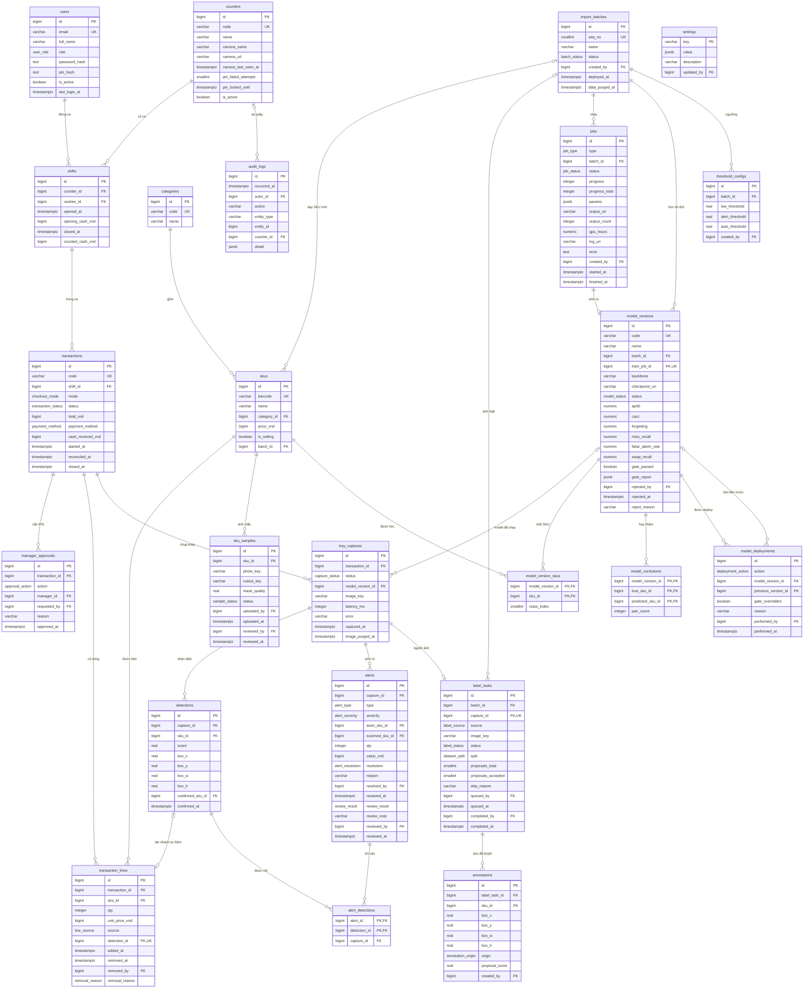
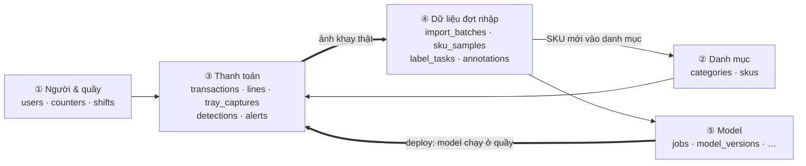
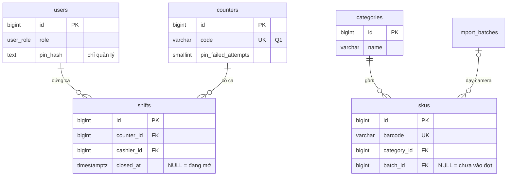
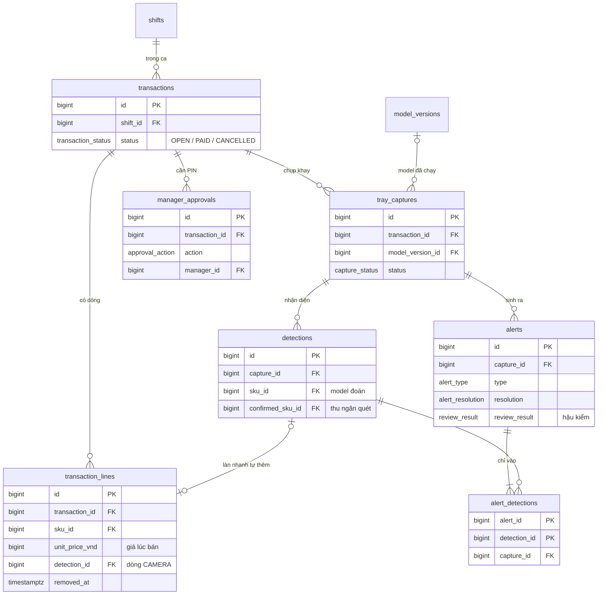
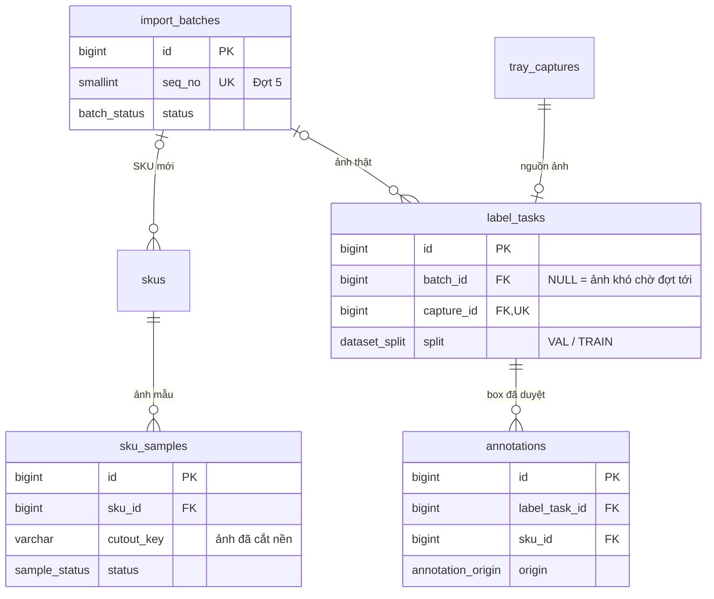
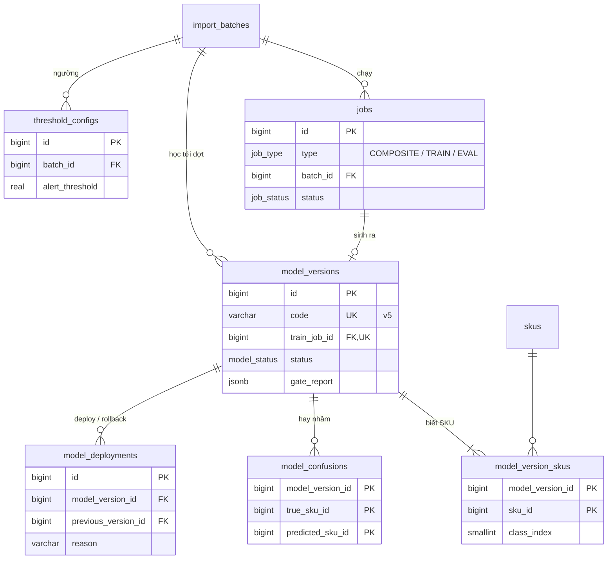

# Bước 5 — Mô hình dữ liệu (DBML / ER)

PostgreSQL 16, một cửa hàng cho mỗi bản cài đặt. 24 bảng chia 6 nhóm. Ảnh nằm trong object storage, database chỉ lưu key của ảnh.

| File | Vai trò |
|---|---|
| [`database/schema.dbml`](../database/schema.dbml) | Nguồn chính: bảng, cột, khóa, CHECK, ghi chú. Dán vào [dbdiagram.io](https://dbdiagram.io) để xem sơ đồ |
| [`database/extras.sql`](../database/extras.sql) | Phần DBML không biểu diễn được: unique có điều kiện, trigger, view, cài đặt mặc định |
| [`database/schema.sql`](../database/schema.sql) | Sinh từ hai file trên bằng `scripts/build_schema.sh`, không sửa tay |
| [`database/test.sql`](../database/test.sql) | Một luồng hợp lệ và 24 dữ liệu sai phải bị chặn đúng ràng buộc |

```bash
scripts/build_schema.sh   # schema.dbml + extras.sql → schema.sql
scripts/check_schema.sh   # nạp schema.sql vào PostgreSQL 16 (Docker) rồi chạy test.sql
scripts/build_diagram.py  # schema.dbml → sơ đồ ER đầy đủ ở mục 1.1 của file này
```

## 1. Tổng quan

### 1.1 Sơ đồ toàn bộ bảng

Đủ 24 bảng và mọi cột, trừ `created_at` / `updated_at`. Sơ đồ sinh tự động từ `schema.dbml` bằng `scripts/build_diagram.py`: sửa DBML xong thì chạy lại script, đừng sửa tay khối bên dưới.

**Cách đọc ký hiệu:** `||` là đúng một, `o|` là không hoặc một, `o{` là không hoặc nhiều. Ví dụ `shifts ||--o{ transactions` nghĩa là một ca có không hoặc nhiều giao dịch, và mỗi giao dịch thuộc đúng một ca.

Để sơ đồ không rối, hai loại đường không vẽ (cột vẫn ghi FK):
- Các cột người thực hiện (`*_by`, `actor_id`, `manager_id`) trỏ tới `users`.
- Các cột SKU của box, cảnh báo, nhãn và cặp hay nhầm (`detections.sku_id`, `alerts.seen_sku_id`…) trỏ tới `skus`.

<!-- er-full:start -->

<!-- er-full:end -->

### 1.2 Đọc theo một vòng nghiệp vụ

Hệ thống là một vòng lặp: bán hàng ở quầy, gặp hàng mới thì thu thập dữ liệu, huấn luyện model, deploy model về quầy, rồi bán tiếp.



| # | Chuyện gì xảy ra | Bảng ghi lại | Nối với |
|---|---|---|---|
| 1 | Chuẩn bị: tài khoản, quầy có camera, danh mục hàng | `users`, `counters`, `categories`, `skus` | SKU thuộc một nhóm hàng |
| 2 | Thu ngân mở ca ở một quầy | `shifts` | Ca = một quầy + một thu ngân |
| 3 | Khách đến, thu ngân quét mã | `transactions`, `transaction_lines` | Giao dịch thuộc ca; dòng hàng thuộc giao dịch, trỏ SKU và chốt giá lúc bán |
| 4 | Camera chụp khay lúc khách đặt hàng | `tray_captures` → `detections` | Ảnh khay thuộc giao dịch và ghi model nào đã chạy; mỗi box là một dòng `detections` |
| 5 | Bấm Thanh toán: đối chiếu ra chênh lệch | `alerts`, `alert_detections` | Cảnh báo thuộc ảnh khay; `alert_detections` chỉ ra box gây cảnh báo |
| 6 | Xử lý: quét bổ sung, báo nhầm, xóa dòng, hủy | Cột trên `alerts` và `transaction_lines`; `manager_approvals` | Hủy giao dịch và bỏ qua kiểm tra cần phiếu PIN của quản lý |
| 7 | Có lô hàng mới | `import_batches`, `skus.batch_id`, `sku_samples` | Đợt gồm các SKU mới; mỗi SKU có ảnh mẫu đã cắt nền |
| 8 | Ảnh khay thật quay về để gán nhãn | `label_tasks` → `annotations` | Mỗi việc gán nhãn lấy một ảnh khay; box đã duyệt thuộc việc đó |
| 9 | Tạo ảnh ghép, huấn luyện | `jobs` → `model_versions` | Job thuộc đợt; job huấn luyện sinh ra một phiên bản model |
| 10 | Duyệt và deploy | `model_deployments`, `threshold_configs` | Bản đang chạy được ghi vào mỗi ảnh khay mới ở bước 4, và vòng lặp tiếp tục |

Nhóm ⑥ (`settings`, `audit_logs`) chạy xuyên suốt: `settings` giữ các con số chỉnh được, `audit_logs` ghi mọi thao tác quan trọng.

## 2. Quy ước

| Mục | Quy ước |
|---|---|
| Tên | Tiếng Anh, `snake_case`, bảng số nhiều. Enum viết hoa (`FALSE_ALARM`); nhãn tiếng Việt chỉ có ở giao diện |
| Khóa | `bigint` identity. Mã hiển thị là cột riêng: `transactions.code` (GD1000), `model_versions.code` (v5), `import_batches.seq_no` (Đợt 5) |
| Tiền, thời gian, box | Tiền là `bigint` VND, cột có hậu tố `_vnd`. Thời gian là `timestamptz`. Box `x, y, w, h` chuẩn hóa 0..1, CHECK không vượt khỏi ảnh |
| Tên ràng buộc | `ck_` CHECK, `ux_` unique, `ix_` index, `trg_` trigger |
| Không xóa lịch sử | Dòng hàng bị xóa chỉ đánh dấu `removed_at`; tài khoản tắt bằng `is_active`, SKU ngừng bán bằng `is_selling`. Chỉ bảng con thuần túy (dòng, box, cảnh báo) mới xóa theo cha |
| Không lưu lặp | Cột suy ra được từ cha thì không lưu lại. Ba ngoại lệ có chủ đích: `total_vnd` chốt tổng lúc trả tiền, `model_versions.status` để tra nhanh bản đang chạy, `gate_passed` là kết luận cổng duyệt |
| Khóa ngoại kép | Khi hai bảng con phải thuộc cùng một cha: box của cảnh báo thuộc đúng ảnh khay của cảnh báo; phiên bản model thuộc đúng đợt của job huấn luyện |
| Tính được thì không lưu | Trạng thái học của SKU, hàng đợi hậu kiểm, tiền thối là view hoặc phép tính (mục 6) |

## 3. Chi tiết theo nhóm

Sơ đồ mỗi nhóm chỉ giữ khóa và vài cột chính; cột đầy đủ xem ở mục 1.1. Bảng không có cột là bảng của nhóm khác.

### 3.1 Người dùng, quầy, danh mục



| Bảng | Một dòng là | Vì sao cần |
|---|---|---|
| `users` | Một tài khoản (thu ngân, quản lý, kỹ sư ML, quản trị) | Phân quyền; mọi thao tác đều có người chịu trách nhiệm |
| `counters` | Một quầy và camera của nó | Địa chỉ chụp ảnh camera; biết camera nào đang hoạt động; đếm sai PIN |
| `shifts` | Một ca của một thu ngân ở một quầy | Đối soát tiền đầu và cuối ca; giao dịch lấy quầy và thu ngân qua ca |
| `categories` | Một nhóm hàng | Hai SKU cùng nhóm là dấu hiệu tráo mã |
| `skus` | Một mặt hàng | Giá, mã vạch, và đợt đã dạy SKU này cho camera |

**Ý chính:**
- Mỗi quầy và mỗi thu ngân chỉ có một ca đang mở (unique có điều kiện `closed_at IS NULL`).
- Chỉ quản lý có PIN (CHECK). PIN nhập ở quầy được so với mọi quản lý nên sai PIN đếm **theo quầy**: sai 3 lần khóa 5 phút.
- Không có bảng `stores` vì mỗi bản cài đặt là một cửa hàng.

### 3.2 Thanh toán tại quầy



| Bảng | Một dòng là | Vì sao cần |
|---|---|---|
| `transactions` | Một lượt khách | Lưu từ lần quét đầu nên giao dịch bị hủy vẫn còn dấu vết |
| `transaction_lines` | Một món đã quét (hoặc camera tự thêm ở làn nhanh) | Hóa đơn; chốt giá lúc bán; dòng bị xóa vẫn giữ để hậu kiểm |
| `tray_captures` | Một lần chụp khay (khi khách đặt hàng, hoặc chụp lại), kể cả lần lỗi | Bằng chứng ảnh; biết model nào đã chạy; đếm lần lỗi |
| `detections` | Một box model nhận diện trên ảnh khay | Vẽ khung trên ảnh; đo độ chính xác thực tế |
| `alerts` | Một chênh lệch giữa khay và hóa đơn | Chặn thanh toán khi mức Cao; nơi ghi báo nhầm và hậu kiểm |
| `alert_detections` | Một cặp cảnh báo ↔ box | Một cảnh báo có thể chỉ vào nhiều box |
| `manager_approvals` | Một lần quản lý nhập PIN | Hủy giao dịch, bỏ qua kiểm tra khay |

**Ý chính:**
- **Giao dịch** đi `OPEN` → `PAID` / `CANCELLED`. Mỗi ca chỉ có một giao dịch `OPEN`. Quầy và thu ngân lấy qua `shift_id`.
- **Đối chiếu** chạy lần đầu khi bấm Thanh toán (`transactions.reconciled_at`). **Cảnh báo** thuộc ảnh khay được đem so. Từ đó mỗi lần quét thêm, đối chiếu chạy lại và cập nhật đúng dòng cũ (unique theo loại + SKU). Mức Cao chỉ đóng bằng quét bổ sung hoặc báo nhầm. Hậu kiểm chỉ áp dụng cho cảnh báo thu ngân báo nhầm.
- **Xóa dòng** không cần PIN: ghi `removed_at`, người xóa, lý do (CHECK bắt cả ba cùng có). Không phải chụp lại: khi đối chiếu, dòng xóa vì `CUSTOMER_DECLINED` được trừ khỏi ảnh.
- **Làn nhanh:** dòng `CAMERA` trỏ box đã tạo ra nó. Box không chắc thì `confirmed_sku_id` ghi SKU thu ngân quét. Khác với SKU model đoán là một lần sửa.
- **Bỏ qua kiểm tra khay** = các lần chụp `FAILED` + một phiếu PIN `SKIP_TRAY_CHECK`, không phải một cảnh báo. Quản lý không tự duyệt cho chính mình (CHECK).

### 3.3 Dữ liệu đợt nhập



| Bảng | Một dòng là | Vì sao cần |
|---|---|---|
| `import_batches` | Một đợt dạy camera một lô SKU mới | Gom dữ liệu, job, model và ngưỡng theo đợt |
| `sku_samples` | Một ảnh chụp SKU mới và ảnh cắt nền của nó | Nguyên liệu tạo ảnh ghép để huấn luyện; kỹ sư ML nhận hoặc loại từng ảnh |
| `label_tasks` | Một ảnh khay thật cần gán nhãn | Tập kiểm tra ảnh thật cho cổng duyệt; ảnh khó để model học thêm |
| `annotations` | Một box đã được người duyệt | Nhãn dùng để đo và huấn luyện |

**Ý chính:**
- Ảnh thật đến từ hai nguồn: giao dịch có quét hàng mới (hệ thống tự đưa vào) hoặc ảnh khó do người gửi. Ảnh được sao sang kho dữ liệu nên không mất theo hạn 30 ngày của giao dịch.
- Ảnh vào tập kiểm tra (`VAL`) trước; chỉ phần vượt mức mới được dùng để huấn luyện. Trigger chặn hai ảnh của cùng một giao dịch nằm ở hai tập khác nhau (BR-16).
- `annotations` chỉ chứa box đã được người chấp nhận (BR-12) và ghi box do model đề xuất hay do người vẽ.
- Ảnh ghép không lưu từng ảnh (hàng chục nghìn ảnh mỗi đợt): chỉ lưu thư mục và số ảnh trên job `COMPOSITE`.
- Hết hạn lưu thì xóa ảnh mẫu và ảnh huấn luyện, nhưng **giữ ảnh tập kiểm tra** để các phiên bản sau còn đo mức quên.

### 3.4 Model



| Bảng | Một dòng là | Vì sao cần |
|---|---|---|
| `jobs` | Một việc chạy nền: tạo ảnh ghép, huấn luyện, đánh giá | Một hàng đợi và một vòng đời chung cho cả ba loại |
| `model_versions` | Một phiên bản model và kết quả cổng duyệt | Chỉ số để so sánh; quyết định deploy kiểm lại được |
| `model_version_skus` | Một SKU mà phiên bản biết | SKU "Đã học" khi bản đang chạy có nó |
| `model_confusions` | Một cặp SKU model hay nhầm | Biết cần bổ sung dữ liệu cho cặp nào |
| `model_deployments` | Một lần deploy hoặc rollback | Lịch sử đầy đủ; biết bản liền trước để rollback |
| `threshold_configs` | Một bộ ngưỡng của một đợt | Chỉnh ngưỡng theo đợt, hoàn tác được |

**Ý chính:**
- Chỉ một phiên bản `ACTIVE` tại một thời điểm (unique có điều kiện, BR-07).
- Khóa ngoại kép (`train_job_id`, `batch_id`) bảo đảm phiên bản thuộc đúng đợt của job đã huấn luyện ra nó.
- `gate_report` chụp lại từng điều kiện cổng duyệt lúc đánh giá. Override cổng duyệt hoặc rollback đều bắt buộc có lý do.
- Rollback không phải sửa `skus`, vì trạng thái học tính từ `model_version_skus` của bản đang chạy.
- `threshold_configs` chỉ ghi thêm: dòng mới nhất là ngưỡng đang áp dụng; CHECK bảo đảm thấp < cảnh báo ≤ tự nhận.

### 3.5 Hệ thống

| Bảng | Một dòng là | Vì sao cần |
|---|---|---|
| `settings` | Một con số chỉnh được (hạn giữ ảnh, cổng duyệt, mục tiêu dữ liệu, hậu kiểm) | Đổi số không cần sửa code; view đọc giá trị từ đây; mặc định nằm trong `extras.sql` |
| `audit_logs` | Một thao tác đã xảy ra: ai, làm gì, trên đối tượng nào, ở quầy nào | Trigger từ chối mọi UPDATE / DELETE / TRUNCATE (US27) |

## 4. Enum

| Enum | Giá trị → nhãn trên giao diện |
|---|---|
| `user_role` | CASHIER Thu ngân · STORE_MANAGER Quản lý cửa hàng · ML_ENGINEER Kỹ sư ML · ADMIN Quản trị viên |
| `checkout_mode` | VERIFY Kiểm tra chéo · FAST Làn nhanh |
| `transaction_status` | OPEN Đang quét · PAID Đã thanh toán · CANCELLED Đã hủy |
| `payment_method` | CASH Tiền mặt · CARD Thẻ · TRANSFER Chuyển khoản |
| `line_source` | BARCODE Mã vạch · CAMERA Camera |
| `capture_status` | SUCCEEDED Đã nhận diện · FAILED Lỗi |
| `alert_type` | UNSCANNED_ITEM Món chưa quét · SUSPECTED_SWAP Nghi tráo mã · SCANNED_NOT_SEEN Quét nhưng camera không thấy |
| `alert_severity` | HIGH Cao · MEDIUM Trung bình · LOW Thấp |
| `alert_resolution` | OPEN Đang mở · SCANNED Đã quét bổ sung · FALSE_ALARM Thu ngân báo nhầm · AUTO_CLOSED Tự đóng khi thanh toán |
| `review_result` | ALERT_CORRECT Cảnh báo đúng · MODEL_ERROR Báo nhầm thật · SUSPECTED_FRAUD Nghi gian lận |
| `approval_action` | CANCEL_TRANSACTION Hủy giao dịch · SKIP_TRAY_CHECK Bỏ qua kiểm tra khay |
| `removal_reason` | CUSTOMER_DECLINED Khách không lấy nữa · WRONG_ITEM Quét nhầm mã · DUPLICATE_SCAN Quét trùng |
| `batch_status` | DRAFT Nháp · COLLECTING Thu thập dữ liệu · TRAINING Huấn luyện · PENDING_REVIEW Chờ duyệt · DEPLOYED Đã deploy |
| `sample_status` | PENDING Chờ duyệt · ACCEPTED Nhận · REJECTED Loại |
| `label_source` | NEW_SKU_SALE Giao dịch có hàng mới · HARD_IMAGE Ảnh khó |
| `label_status` | PENDING Chờ gán · LABELED Đã gán · SKIPPED Bỏ qua |
| `dataset_split` | VAL Tập kiểm tra · TRAIN Huấn luyện |
| `annotation_origin` | MODEL_PROPOSAL Model đề xuất · MANUAL Người vẽ |
| `job_type` | COMPOSITE Tạo ảnh ghép · TRAIN Huấn luyện · EVAL Đánh giá |
| `job_status` | QUEUED Chờ · RUNNING Đang chạy · EVALUATING Đang đánh giá · SUCCEEDED Xong · FAILED Lỗi · CANCELLED Đã hủy |
| `model_status` | PENDING_REVIEW Chờ duyệt · ACTIVE Đang chạy · RETIRED Đã thay thế · REJECTED Bị từ chối |
| `deployment_action` | DEPLOY Deploy · ROLLBACK Rollback |

Trạng thái học của SKU (LEARNED Đã học · LEARNING Đang học · NOT_LEARNED Chưa học) là kết quả của view, không phải cột.

## 5. Quy tắc nghiệp vụ trong database

| Quy tắc | Cách đảm bảo |
|---|---|
| BR-03 Cảnh báo Cao không tự đóng | `ck_alerts_resolution_by_severity` |
| BR-04 Báo nhầm có lý do, người và thời gian | `ck_alerts_false_alarm`, `ck_alerts_resolver`; ảnh khay giữ trong `tray_captures` |
| BR-05 Xóa dòng có người và lý do; hủy, bỏ qua cần PIN | `ck_transaction_lines_removal`; `manager_approvals`, `ck_manager_approvals_other_person` |
| BR-06 Giao dịch lưu đủ bằng chứng | `unit_price_vnd`, `tray_captures.model_version_id`, `detections`, `alerts` |
| BR-07 Một model chạy | `ux_model_versions_active` |
| BR-08 Deploy qua cổng duyệt hoặc có lý do; rollback được | `gate_report`, `model_deployments.previous_version_id`, `ck_model_deployments_reason`, `ck_model_deployments_rollback_from` |
| BR-09, BR-11 Cổng duyệt, đủ dữ liệu mới huấn luyện | Ngưỡng trong `settings`; view `v_batch_readiness` |
| BR-10 Ngưỡng theo đợt | `threshold_configs`, `ck_threshold_configs_order` |
| BR-12 Chỉ box đã chấp nhận thành nhãn | `annotations` chỉ chứa box đã chấp nhận, ghi nguồn |
| BR-13 Hạn giữ ảnh | `settings.retention.*`, `tray_captures.image_purged_at`, `import_batches.data_purged_at`; ảnh gán nhãn có bản sao riêng; ảnh tập kiểm tra không bị xóa |
| BR-14 Mã vạch không trùng | `skus.barcode` unique + CHECK định dạng |
| BR-16 Một giao dịch chỉ ở một tập | Trigger `trg_label_tasks_split` |
| BR-17 Thứ tự hậu kiểm | View `v_cashier_alert_stats`, `v_cashier_removal_stats`, `v_review_queue`, `v_false_alarm_pairs`; tham số trong `settings.audit.*` |
| US08 PIN chỉ của quản lý, khóa khi sai | `ck_users_pin_manager_only`; `counters.pin_failed_attempts`, `counters.pin_locked_until` |
| US27 Nhật ký không sửa được | Trigger `trg_audit_logs_no_update`, `trg_audit_logs_no_truncate` |
| Một ca mở mỗi quầy, một giao dịch mở mỗi ca, cảnh báo không trùng | `ux_shifts_open_counter`, `ux_shifts_open_cashier`, `ux_transactions_open`, `ux_alerts_identity` |

Những quy tắc cần dữ liệu của nhiều bảng hoặc cần biết ai đang đăng nhập thì backend kiểm, không làm trong database. Ví dụ: còn cảnh báo Cao thì chưa cho thanh toán (BR-03), món khách trả lại được trừ khỏi ảnh khi đối chiếu (BR-05), ảnh thật phải có box cho mọi món (BR-12), phân quyền (BR-15).

## 6. Dữ liệu suy ra

| View | Màn hình | Nội dung |
|---|---|---|
| `v_sku_learn_status` | M05, M06, P01 | Đã học = có trong bản `ACTIVE`; Đang học = thuộc một đợt chưa deploy (kể cả sau rollback); còn lại Chưa học |
| `v_batch_sku_progress`, `v_batch_readiness` | M08 | Ảnh mẫu đã nhận, box trong tập kiểm tra theo SKU; số ảnh kiểm tra; đã có ảnh ghép chưa |
| `v_cashier_alert_stats` | M02 | Số cảnh báo Cao/TB, số báo nhầm, tỉ lệ của từng thu ngân so với cửa hàng, cờ bất thường |
| `v_cashier_removal_stats` | M02 | Số dòng thu ngân đã xóa, giá trị, số dòng xóa trên mỗi giao dịch so với cửa hàng, cờ bất thường |
| `v_review_queue` | M01, M02 | Báo nhầm chờ hậu kiểm và lý do xem trước: giá trị cao, thu ngân bất thường, mẫu ngẫu nhiên (cố định theo id) |
| `v_false_alarm_pairs` | L07 | Cặp SKU bị báo nhầm, số lần, số thu ngân; nhiều thu ngân gặp cùng một cặp là lỗi model |

Những giá trị khác không lưu vì tính được ngay khi cần:
- Tiền thối = `cash_received_vnd − total_vnd`.
- Tiền dự kiến cuối ca = tiền đầu ca + tiền mặt các giao dịch đã thanh toán.
- Số lần sửa ở làn nhanh = số box có `confirmed_sku_id ≠ sku_id`.
- Camera trực tuyến = `camera_last_seen_at` nằm trong 30 giây gần nhất.

## 7. Prototype → bảng

| Prototype (`frontend/src`) | Bảng |
|---|---|
| `User`, `MANAGER_PIN` | `users` (PIN của từng quản lý, đã hash); đếm sai PIN ở `counters` |
| `Counter`, `Shift` | `counters`, `shifts` |
| `Sku` (`category`, `task`), `CATEGORIES` | `skus` (`category_id`, `batch_id`), `categories` |
| `Transaction` (`counterId`, `cashier`) | `transactions`; quầy và thu ngân lấy qua `shifts` |
| `trayId`, `modelVersion` | `tray_captures.image_key`, `tray_captures.model_version_id` |
| `TxLine` | `transaction_lines` |
| `AlertRecord` (`detectionIds`, `review`) | `alerts`, `alert_detections` |
| `corrections` | Đếm `detections.confirmed_sku_id ≠ sku_id` |
| `Batch` | `import_batches` |
| `Cutout`, `cutoutState` | `sku_samples` |
| `composites` | `jobs` loại `COMPOSITE` |
| `labelQueue`, `labeledTrays`, `approved`, `valImages` | `label_tasks`, `annotations`, view `v_batch_sku_progress` |
| `Job` | `jobs` loại `TRAIN` / `EVAL` |
| `ModelVersion`, `versionStatus`, `CONFUSED_PAIRS` | `model_versions`, `model_confusions` |
| `deploy`, `rollback` | `model_deployments` |
| `thresholds` | `threshold_configs` |
| `retention`, hằng số trong `app/rules.ts`, `lib/audit.ts`, `GATE` | `settings` |
| `AuditEntry` | `audit_logs` |
