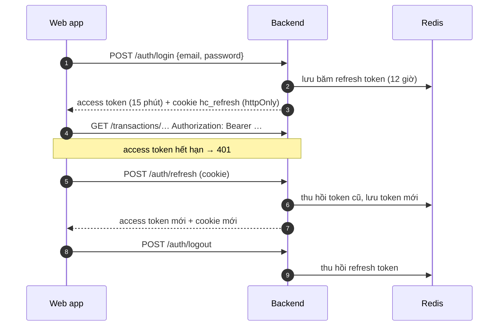

# Bước 6 — OpenAPI

Contract REST của backend, viết trước khi code (design-first). Backend FastAPI phải khớp contract; frontend sinh kiểu TypeScript từ contract.

| File | Vai trò |
|---|---|
| [`api/openapi.yaml`](../api/openapi.yaml) | **Nguồn gốc.** API cho web app: OpenAPI 3.1 |
| [`api/inference.openapi.yaml`](../api/inference.openapi.yaml) | API nội bộ của dịch vụ nhận diện, chỉ backend và worker gọi |
| [`api/redocly.yaml`](../api/redocly.yaml) | Luật lint (`recommended-strict`) |

```bash
scripts/check_api.sh                                   # lint 2 contract + sinh lại bảng endpoint ở mục 4
npx @redocly/cli@2.64.1 preview -d api                 # xem tài liệu API trên trình duyệt
```

## 1. Quy ước

| Chủ đề | Quy ước |
|---|---|
| Đường dẫn | `/api/v1`, danh từ số nhiều, kebab-case: `/transactions/{transactionId}/tray-checks` |
| Tên | path, field, enum tiếng Anh, khớp `database/schema.dbml`; field `snake_case`; enum `UPPER_CASE`; mô tả tiếng Việt |
| Thao tác nghiệp vụ | Động từ là sub-resource `POST`: `/pay`, `/cancel`, `/false-alarm`, `/deploy`. CRUD thường dùng `GET` `POST` `PATCH` `DELETE` |
| Dữ liệu | Tiền: số nguyên VND, hậu tố `_vnd` · Thời điểm: ISO 8601 có múi giờ · Box: `{x, y, w, h}` chuẩn hóa 0..1 · Id: số nguyên |
| Danh sách | `?page=1&page_size=20` (tối đa 100) → `{items, page, page_size, total}`; mới nhất trước |
| Mã trạng thái | `200` đọc/sửa · `201` tạo (+ `Location`) · `202` đã xếp job · `204` không có nội dung · `4xx` lỗi người gọi · `5xx` lỗi hệ thống |
| Lỗi | `application/problem+json` (RFC 9457) với `code` ổn định, ví dụ `PAYMENT_BLOCKED`. Frontend rẽ nhánh theo `code`, không theo câu chữ |
| Gửi lại an toàn | `POST /transactions` và `POST /transactions/{id}/pay` bắt buộc header `Idempotency-Key` (UUID). Gửi lại cùng key trả đúng kết quả lần đầu, không tính tiền hai lần |
| Việc chạy lâu | Ghép ảnh, huấn luyện trả `202` + `Job`; frontend hỏi `GET /jobs/{id}` mỗi 3 giây |
| Ảnh | API không trả file ảnh; trả URL ký sẵn của kho ảnh (S3), hết hạn sau 10 phút |
| Phân quyền | Kiểm tra ở backend cho mọi thao tác (BR-15); `x-roles` ghi vai trò được gọi |

## 2. Xác thực



- **Access token** chỉ nằm trong bộ nhớ trang (không `localStorage`), nên tải lại trang thì gọi `/auth/refresh`.
- **Refresh token** 12 giờ, đủ một ca. Mỗi lần dùng là đổi token mới. Khóa tài khoản hoặc đổi mật khẩu sẽ thu hồi mọi token của người đó.
- **PIN quản lý** không phải đăng nhập. Quản lý nhập PIN ngay trên phiên của thu ngân, gửi kèm thao tác cần xác nhận (`/cancel`, `/skip-tray-check`). Backend so PIN với mọi quản lý đang hoạt động. Sai 3 lần thì quầy khóa nhập PIN 5 phút, trả `423`.

## 3. Luồng chính tại quầy

Mọi thao tác ở quầy đều trả về cùng một đối tượng **`Checkout`**: dòng hàng, dòng đã xóa, lần chụp gần nhất kèm box, cảnh báo và `pay_blockers`. Màn quầy vẽ lại từ đối tượng này, không tự tính trạng thái.

| Bước | Kiểm tra chéo | Làn nhanh |
|---|---|---|
| 1 | `POST /transactions {mode: VERIFY}` ở lần quét đầu, rồi ngay `POST …/tray-checks`: chụp lúc hàng còn trên quầy, chưa sinh cảnh báo | `POST /transactions {mode: FAST}` |
| 2 | `POST …/lines {barcode}` cho từng món | `POST …/tray-checks`: món chắc chắn tự vào giỏ, box không chắc có `state: NEEDS_CONFIRMATION` |
| 3 | Bấm Thanh toán → `POST …/reconciliation`: đối chiếu ảnh lúc đầu với danh sách đã quét, sinh cảnh báo | `POST …/lines {barcode, detection_id}` cho từng box cam và món không có box |
| 4 | Xử lý cảnh báo: quét bổ sung (`POST …/lines`, cảnh báo tự đóng) hoặc `POST /alerts/{id}/false-alarm {reason}` | Như cột trái |
| 5 | `pay_blockers` rỗng → hộp thoại thanh toán → `POST …/pay {payment_method, cash_received_vnd}` | `POST …/pay {…, confirmed_all_scanned: true}` |

Thu ngân không bấm nút "kiểm tra khay" nào: ảnh được chụp khi khách đặt hàng, đối chiếu chạy khi bấm Thanh toán. Ngoài luồng chính: xóa dòng bằng `DELETE …/lines/{lineId}?reason=CUSTOMER_DECLINED`, không phải chụp lại (khi đối chiếu, món khách trả lại được trừ khỏi ảnh). Hủy giao dịch và bỏ qua kiểm tra khay cần PIN quản lý.

**Backend đối chiếu và kiểm tra lại khi thanh toán** (không tin nút trên giao diện). Còn lý do nào thì trả `409 PAYMENT_BLOCKED` kèm `blockers`:

| `PayBlocker` | Khi nào | Gỡ bằng |
|---|---|---|
| `EMPTY_CART` | Không còn dòng nào | Quét món |
| `TRAY_NOT_CAPTURED` | Chưa có lần chụp thành công | Chụp lại khay |
| `CAPTURE_FAILED` | Lần chụp gần nhất lỗi | Chụp lại khay; sau 2 lần lỗi: bỏ qua kiểm tra (PIN) |
| `OPEN_HIGH_ALERTS` | Còn cảnh báo mức Cao (BR-03) | Quét bổ sung hoặc báo nhầm |
| `UNCONFIRMED_DETECTIONS` | Làn nhanh còn box cam chưa quét (US10) | Quét món đó |

Camera hoặc dịch vụ nhận diện lỗi **không** làm `tray-checks` trả lỗi HTTP. Lần chụp vẫn được lưu với `status: FAILED`, nhờ đó backend đếm được `failed_captures_in_row` và quầy vẫn bán bằng mã vạch.

## 4. Danh sách endpoint

Vai trò: **TN** Thu ngân · **QL** Quản lý cửa hàng · **ML** Kỹ sư ML · **AD** Quản trị viên. Thu ngân chỉ thấy dữ liệu ca của mình; backend tự lọc theo người gọi.

<!-- api-table:start -->
78 thao tác, sinh từ `api/openapi.yaml`.

**Auth** — Đăng nhập, làm mới token, đăng xuất.

| | Path | Thao tác | Vai trò |
|---|---|---|---|
| `POST` | `/auth/login` | Đăng nhập | công khai |
| `POST` | `/auth/refresh` | Làm mới access token | đã đăng nhập |
| `POST` | `/auth/logout` | Đăng xuất | TN, QL, ML, AD |

**Profile** — Hồ sơ của người đang đăng nhập, đổi mật khẩu, PIN quản lý.

| | Path | Thao tác | Vai trò |
|---|---|---|---|
| `GET` | `/me` | Xem hồ sơ | TN, QL, ML, AD |
| `PATCH` | `/me` | Sửa họ tên | TN, QL, ML, AD |
| `PUT` | `/me/password` | Đổi mật khẩu | TN, QL, ML, AD |
| `PUT` | `/me/pin` | Đặt hoặc đổi PIN quản lý | QL |

**Counters** — Quầy và camera; thu ngân xem để chọn quầy, quản trị viên thêm và sửa.

| | Path | Thao tác | Vai trò |
|---|---|---|---|
| `GET` | `/counters` | Danh sách quầy | TN, QL, AD |
| `POST` | `/counters` | Thêm quầy | AD |
| `PATCH` | `/counters/{counterId}` | Sửa quầy, gán camera, ngừng dùng | AD |
| `POST` | `/counters/{counterId}/test-capture` | Chụp thử camera | TN, QL, AD |

**Shifts** — Mở ca, tổng kết ca, đóng ca.

| | Path | Thao tác | Vai trò |
|---|---|---|---|
| `POST` | `/shifts` | Mở ca | TN, QL |
| `GET` | `/shifts/current` | Ca đang mở của tôi | TN, QL |
| `GET` | `/shifts/{shiftId}/summary` | Tổng kết ca | TN, QL |
| `POST` | `/shifts/{shiftId}/close` | Đóng ca | TN, QL |

**Checkout** — Giao dịch tại quầy — quét mã, chụp và đối chiếu khay, xóa dòng, thanh toán, hủy (UC05–UC12).

| | Path | Thao tác | Vai trò |
|---|---|---|---|
| `GET` | `/transactions` | Danh sách giao dịch | TN, QL |
| `POST` | `/transactions` | Bắt đầu giao dịch | TN, QL |
| `GET` | `/transactions/{transactionId}` | Xem giao dịch | TN, QL, ML |
| `PATCH` | `/transactions/{transactionId}` | Đổi chế độ quầy | TN, QL |
| `POST` | `/transactions/{transactionId}/lines` | Quét mã một món | TN, QL |
| `DELETE` | `/transactions/{transactionId}/lines/{lineId}` | Xóa dòng | TN, QL |
| `POST` | `/transactions/{transactionId}/tray-checks` | Chụp khay | TN, QL |
| `POST` | `/transactions/{transactionId}/reconciliation` | Đối chiếu khay | TN, QL |
| `POST` | `/transactions/{transactionId}/pay` | Thanh toán | TN, QL |
| `POST` | `/transactions/{transactionId}/cancel` | Hủy giao dịch (PIN quản lý) | TN, QL |
| `POST` | `/transactions/{transactionId}/skip-tray-check` | Bỏ qua kiểm tra khay (PIN quản lý) | TN, QL |

**Alerts** — Cảnh báo đối chiếu, báo nhầm, hậu kiểm theo ưu tiên (UC08, UC14, BR-04, BR-17).

| | Path | Thao tác | Vai trò |
|---|---|---|---|
| `GET` | `/alerts` | Danh sách cảnh báo | QL, ML |
| `GET` | `/alerts/review-queue` | Báo nhầm cần hậu kiểm trước | QL |
| `POST` | `/alerts/{alertId}/false-alarm` | Thu ngân xác nhận camera báo nhầm | TN, QL |
| `PUT` | `/alerts/{alertId}/review` | Hậu kiểm một báo nhầm | QL |

**Catalog** — Nhóm hàng và danh mục SKU (UC15).

| | Path | Thao tác | Vai trò |
|---|---|---|---|
| `GET` | `/categories` | Danh sách nhóm hàng | TN, QL, ML |
| `GET` | `/skus` | Danh mục SKU | TN, QL, ML |
| `POST` | `/skus` | Thêm SKU | QL |
| `POST` | `/skus/import` | Nhập SKU từ CSV | QL |
| `GET` | `/skus/{skuId}` | Chi tiết SKU | QL, ML |
| `PATCH` | `/skus/{skuId}` | Sửa SKU, đổi giá, ngừng bán | QL |

**Batches** — Đợt nhập, ảnh mẫu, ảnh ghép, gửi huấn luyện (UC16, UC17, UC19).

| | Path | Thao tác | Vai trò |
|---|---|---|---|
| `GET` | `/batches` | Danh sách đợt nhập | QL, ML |
| `POST` | `/batches` | Tạo đợt nhập | QL |
| `GET` | `/batches/{batchId}` | Chi tiết đợt nhập | QL, ML |
| `GET` | `/batches/{batchId}/samples` | Ảnh mẫu và ảnh cắt nền của đợt | QL, ML |
| `POST` | `/batches/{batchId}/samples` | Tải ảnh mẫu của một SKU mới | QL, ML |
| `POST` | `/batches/{batchId}/samples/review` | Nhận hoặc loại ảnh cắt (hàng loạt) | ML |
| `POST` | `/batches/{batchId}/composites` | Tạo ảnh ghép | ML |
| `POST` | `/batches/{batchId}/training` | Gửi huấn luyện | ML |

**Labeling** — Gán nhãn ảnh thật có trợ lý và hàng đợi ảnh khó (UC18).

| | Path | Thao tác | Vai trò |
|---|---|---|---|
| `GET` | `/label-tasks` | Hàng đợi ảnh thật | ML |
| `POST` | `/label-tasks` | Gửi ảnh khay vào hàng đợi ảnh khó | QL, ML |
| `GET` | `/label-tasks/next` | Ảnh tiếp theo cần gán nhãn | ML |
| `GET` | `/label-tasks/{taskId}` | Xem một ảnh cần gán nhãn | ML |
| `POST` | `/label-tasks/{taskId}/submit` | Lưu nhãn vào tập dữ liệu | ML |
| `POST` | `/label-tasks/{taskId}/skip` | Bỏ qua ảnh | ML |

**Jobs** — Job chạy nền — ghép ảnh, huấn luyện, đánh giá (UC20).

| | Path | Thao tác | Vai trò |
|---|---|---|---|
| `GET` | `/jobs` | Danh sách job | QL, ML |
| `GET` | `/jobs/{jobId}` | Xem job | QL, ML |
| `GET` | `/jobs/{jobId}/log` | Xem log job | ML |
| `POST` | `/jobs/{jobId}/cancel` | Hủy job | ML |
| `POST` | `/jobs/{jobId}/retry` | Chạy lại job | ML |

**Models** — Phiên bản model, cổng duyệt, deploy, rollback (UC21, UC22).

| | Path | Thao tác | Vai trò |
|---|---|---|---|
| `GET` | `/model-versions` | Danh sách phiên bản model | QL, ML |
| `GET` | `/model-versions/active` | Phiên bản đang chạy | TN, QL, ML, AD |
| `GET` | `/model-versions/{versionId}` | Chi tiết phiên bản và cổng duyệt | QL, ML |
| `POST` | `/model-versions/{versionId}/deploy` | Deploy phiên bản | ML |
| `POST` | `/model-versions/{versionId}/reject` | Từ chối phiên bản | ML |
| `GET` | `/model-deployments` | Lịch sử deploy và rollback | QL, ML |
| `POST` | `/model-deployments/rollback` | Rollback về phiên bản liền trước | ML |

**Thresholds** — Ngưỡng nhận diện theo đợt, xem trước tác động, lịch sử (UC23).

| | Path | Thao tác | Vai trò |
|---|---|---|---|
| `GET` | `/thresholds` | Ngưỡng đang áp dụng theo đợt | ML |
| `POST` | `/thresholds` | Lưu ngưỡng mới cho một đợt | ML |
| `GET` | `/thresholds/history` | Lịch sử ngưỡng của một đợt | ML |
| `POST` | `/thresholds/preview` | Xem trước tác động của ngưỡng | ML |

**Reports** — Dashboard, thống kê theo thu ngân, giám sát model (UC13, UC24).

| | Path | Thao tác | Vai trò |
|---|---|---|---|
| `GET` | `/reports/dashboard` | Dashboard cửa hàng | QL, ML |
| `GET` | `/reports/cashiers` | Báo nhầm và xóa dòng theo thu ngân | QL |
| `GET` | `/reports/monitoring` | Giám sát model | QL, ML |

**Users** — Quản trị người dùng (UC25).

| | Path | Thao tác | Vai trò |
|---|---|---|---|
| `GET` | `/users` | Danh sách người dùng | AD |
| `POST` | `/users` | Tạo người dùng | AD |
| `PATCH` | `/users/{userId}` | Sửa, đổi vai trò, khóa hoặc mở khóa | AD |
| `POST` | `/users/{userId}/reset-password` | Đặt lại mật khẩu | AD |

**System** — Nhật ký, cài đặt lưu trữ, health check (UC27, UC28).

| | Path | Thao tác | Vai trò |
|---|---|---|---|
| `GET` | `/audit-logs` | Nhật ký thao tác | QL, AD |
| `GET` | `/settings` | Cài đặt | AD |
| `PATCH` | `/settings` | Sửa cài đặt | AD |
| `GET` | `/storage-usage` | Dung lượng lưu trữ | AD |
| `GET` | `/health` | Health check | công khai |
<!-- api-table:end -->

## 5. Mã lỗi nghiệp vụ

Lỗi chung: `UNAUTHENTICATED` 401 · `FORBIDDEN` 403 · `NOT_FOUND` 404 · `VALIDATION_ERROR` 422 (kèm `errors[]` theo field) · `RATE_LIMITED` 429.

| Nhóm | `code` → HTTP |
|---|---|
| Đăng nhập, PIN | `INVALID_CREDENTIALS` 401 · `PIN_INVALID` 403 (kèm `attempts_left`) · `PIN_OWN` 403 · `PIN_LOCKED` 423 (kèm `Retry-After`) |
| Ca | `SHIFT_ALREADY_OPEN` 409 · `NO_OPEN_SHIFT` 404/409 · `TRANSACTION_STILL_OPEN` 409 · `SHIFT_CLOSED` 409 |
| Giao dịch | `TRANSACTION_ALREADY_OPEN` · `TRANSACTION_NOT_OPEN` · `MODE_LOCKED` · `LINE_ALREADY_REMOVED` · `DETECTION_ALREADY_CONFIRMED` · `SKIP_NOT_ALLOWED` · `PAYMENT_BLOCKED` · `IDEMPOTENCY_KEY_REUSED` — đều 409. `BARCODE_NOT_FOUND` · `SKU_NOT_SELLING` · `CASH_NOT_ENOUGH` · `OUTSIDE_ZONE_NOT_CONFIRMED` — đều 422 |
| Cảnh báo | `ALERT_NOT_OPEN` · `ALERT_LOW_SEVERITY` · `ALERT_NOT_FALSE_ALARM` — 409 |
| Danh mục, người dùng | `BARCODE_TAKEN` · `EMAIL_TAKEN` · `SELF_CHANGE_FORBIDDEN` · `USER_HAS_OPEN_SHIFT` — 409 |
| Đợt nhập, gán nhãn | `SKU_NOT_UNLEARNED` · `SKU_NOT_IN_BATCH` · `BATCH_NOT_COLLECTING` · `CUTOUT_NOT_READY` · `BATCH_NOT_READY` (kèm `unmet[]`) · `TASK_NOT_PENDING` · `PROPOSALS_UNDECIDED` · `COUNT_MISMATCH` · `ALREADY_QUEUED` · `IMAGE_PURGED` — 409 |
| Job, model | `JOB_ALREADY_RUNNING` · `JOB_FINISHED` · `JOB_NOT_RETRYABLE` · `VERSION_NOT_PENDING` · `GATE_REASON_REQUIRED` · `NO_PREVIOUS_VERSION` · `NO_ACTIVE_MODEL` — 409 (`NO_ACTIVE_MODEL` là 404 ở `GET /model-versions/active`) |
| Thiết bị, dịch vụ | `CAMERA_UNAVAILABLE` 502 (chỉ ở chụp thử) · `INFERENCE_UNAVAILABLE` 503 (deploy, rollback: không có gì bị đổi) |

## 6. Dịch vụ nhận diện (API nội bộ)

Dịch vụ bọc model nhận diện đang nghiên cứu (D07). Nó không truy cập PostgreSQL và không biết gì về nghiệp vụ. Ngưỡng cảnh báo, đối chiếu và tự thêm món đều do backend làm.

| | Path | Ai gọi | Làm gì |
|---|---|---|---|
| `POST` | `/detect` | Backend, khi chụp khay | Ảnh khay → box `{sku_id, score, box}` có độ tin ≥ `min_score` |
| `POST` | `/cutouts` | Worker, sau khi tải ảnh mẫu | Ảnh mẫu → PNG đã cắt nền + `X-Mask-Quality` |
| `GET` `PUT` | `/model` | Backend, khi deploy / rollback | Nạp checkpoint và chạy thử rồi mới thay bản cũ; lỗi thì bản cũ vẫn chạy |
| `GET` | `/health` | Backend, docker | `ready: false` khi chưa nạp checkpoint |

Huấn luyện **không** đi qua HTTP: worker GPU gọi thẳng code huấn luyện của model (xem [Bước 7](07-c4.md)).

## 7. Màn hình → API

| Màn hình | Thao tác chính |
|---|---|
| P01 Mở ca | `listCounters`, `testCapture`, `openShift` |
| P02, P03 Quầy | `getCurrentShift`, `createTransaction`, `scanItem`, `checkTray`, `confirmFalseAlarm`, `removeLine`, `payTransaction`, `cancelTransaction`, `skipTrayCheck`, `getActiveModelVersion` |
| P06 Lịch sử ca | `getShiftSummary`, `listTransactions?shift_id=`, `closeShift` |
| M01 Dashboard | `getDashboard` |
| M02 Cảnh báo & Hậu kiểm | `listAlerts`, `getReviewQueue`, `getCashierStats` |
| M03 Chi tiết giao dịch | `getTransaction`, `reviewAlert`, `queueHardImage` |
| M05, M06 SKU | `listSkus`, `createSku`, `importSkus`, `getSku`, `updateSku`, `listCategories` |
| M07, M08 Đợt nhập | `listBatches`, `createBatch`, `getBatch`, `startTraining` |
| L01 Ảnh mẫu | `listSamples`, `uploadSamples`, `reviewSamples`, `createComposites` |
| L02 Gán nhãn | `getNextLabelTask`, `getLabelTask`, `submitLabels`, `skipLabelTask` |
| L03 Job | `listJobs`, `getJob`, `getJobLog`, `cancelJob`, `retryJob` |
| L04, L05 Phiên bản | `listModelVersions`, `getModelVersion`, `deployModelVersion`, `rejectModelVersion`, `rollbackModel`, `listDeployments` |
| L06 Ngưỡng | `listThresholds`, `previewThresholds`, `saveThresholds`, `listThresholdHistory` |
| L07 Giám sát | `getMonitoring`, `queueHardImage` |
| A01–A04 Quản trị | `listUsers`, `createUser`, `updateUser`, `resetPassword`, `createCounter`, `updateCounter`, `listAuditLogs`, `listSettings`, `updateSettings`, `getStorageUsage` |
| S01, S02 | `login`, `refreshToken`, `logout`, `getMe`, `updateMe`, `changePassword`, `setManagerPin` |

## 8. Quyết định

| Quyết định | Lý do |
|---|---|
| Design-first, viết YAML tay | Contract được duyệt trước khi code; FastAPI vẫn sinh `/openapi.json` và CI so sánh bản sinh với contract (Bước 9) |
| Thao tác quầy trả nguyên `Checkout` | Một lượt gọi là đủ vẽ lại màn quầy; quy tắc khóa thanh toán nằm ở một chỗ (backend) |
| Lỗi chụp khay là dữ liệu, không phải lỗi HTTP | Cần đếm số lần lỗi để cho bỏ qua (UC05); quầy vẫn bán được |
| Backend tự chụp camera, trình duyệt không gửi ảnh | Thu ngân không thể gửi ảnh khác thay cho ảnh khay thật |
| `Idempotency-Key` cho tạo giao dịch và thanh toán | Mạng ở quầy chập chờn; bấm lại không được tính tiền hai lần |
| Refresh token trong cookie httpOnly, access token trong bộ nhớ | Script lạ trên trang không đọc được token dài hạn |
| Phân trang `page`/`page_size` | Bảng quản trị cần tổng số trang; dữ liệu một cửa hàng đủ nhỏ |
| Thay đổi DB khi viết API: thêm `counters.camera_url` | Backend cần địa chỉ chụp ảnh của camera IP |
