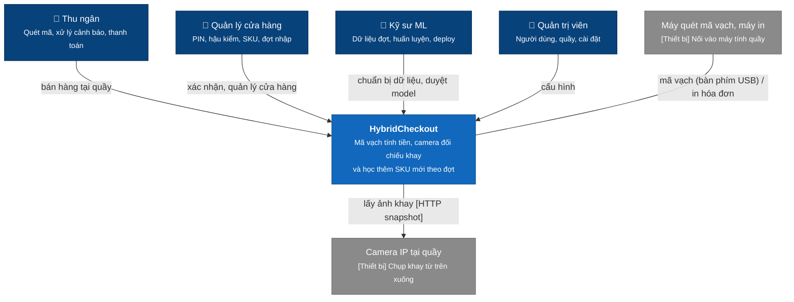
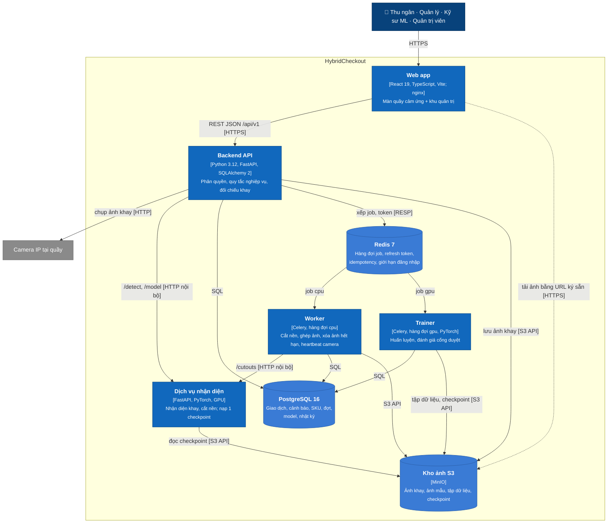
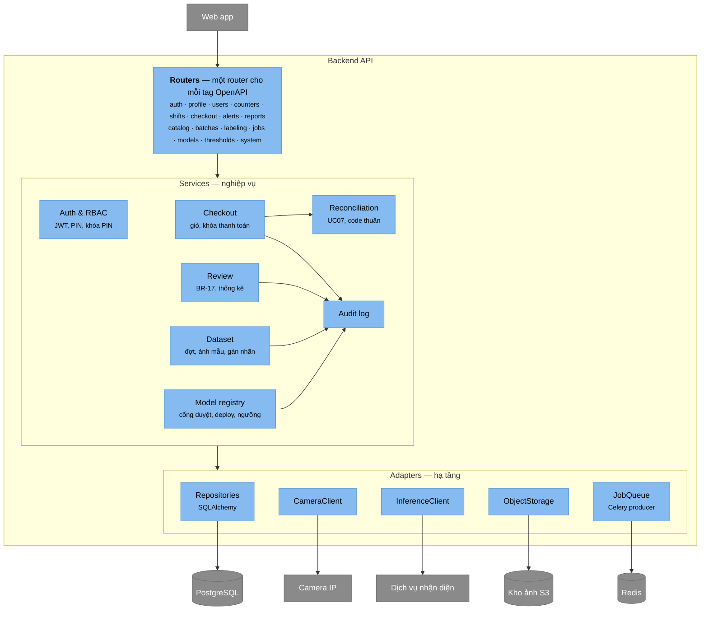
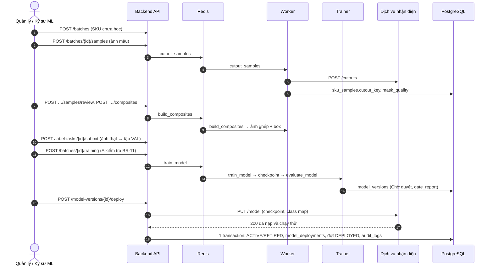
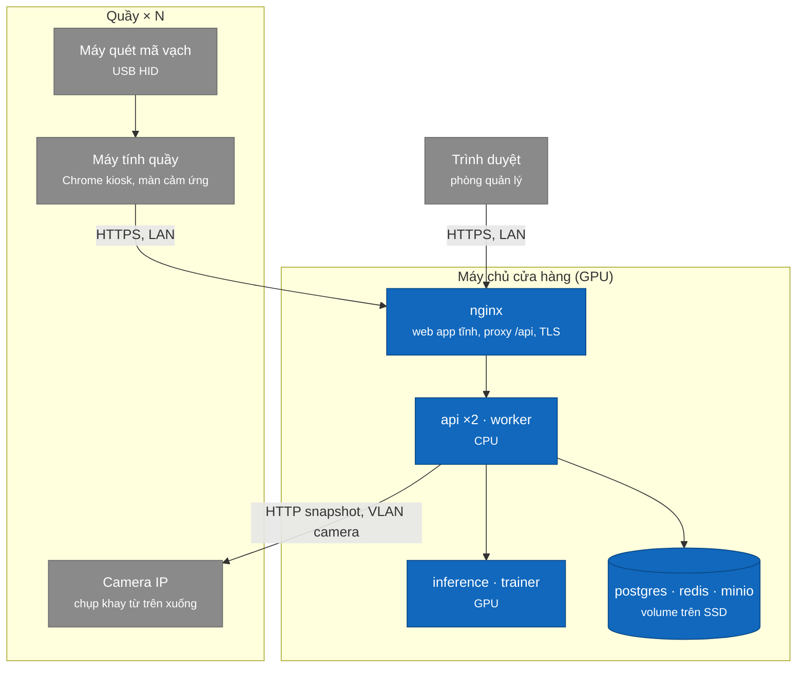

# Bước 7 — Kiến trúc (C4)

Mô hình [C4](https://c4model.com) đi từ ngoài vào trong: **C1** hệ thống và người dùng → **C2** các container chạy được → **C3** thành phần bên trong backend và worker. Bổ sung hai sơ đồ động (luồng chạy) và sơ đồ triển khai. Mức C4 Code bỏ qua vì sẽ đọc thẳng từ code ([Bước 8](08-code-structure.md)).

Ký hiệu màu: xanh đậm là người dùng · xanh là phần đang mô tả · xanh nhạt là thành phần bên trong · xám là bên ngoài phần đang mô tả. Mỗi mũi tên ghi việc gì và giao thức.

## 1. C1 — Ngữ cảnh hệ thống



**Ngoài phạm vi** (Bước 1): thanh toán thật (thẻ và chuyển khoản là giả lập), kết nối POS/ERP có sẵn, quầy tự thanh toán. Mỗi bản cài phục vụ **một cửa hàng**.

## 2. C2 — Container



| Container | Trách nhiệm | Vì sao tách riêng |
|---|---|---|
| Web app | Giao diện, điều hướng theo vai trò; không chứa quy tắc nghiệp vụ có tính quyết định | Phục vụ file tĩnh, cache được |
| Backend API | **Ranh giới tin cậy duy nhất**: xác thực, phân quyền, mọi quy tắc BR, đối chiếu khay (UC07), ghi nhật ký | — |
| Worker | Job CPU chạy nền và định kỳ (Celery beat): cắt nền qua dịch vụ nhận diện, ghép ảnh, xóa ảnh theo BR-13, heartbeat camera | Không làm chậm request tại quầy |
| Trainer | Huấn luyện và đánh giá trên GPU; ghi tiến độ job và phiên bản model | Chiếm GPU hàng giờ; chạy được trên máy GPU khác |
| Dịch vụ nhận diện | Suy luận nhanh, giữ model trong bộ nhớ GPU; không biết nghiệp vụ, không vào DB (D07) | Đổi model không cần sửa backend; khởi động lại không ảnh hưởng quầy |
| PostgreSQL | Dữ liệu nghiệp vụ, ràng buộc toàn vẹn (Bước 5) | — |
| Redis | Broker Celery; trạng thái ngắn hạn có TTL | Không đưa dữ liệu tạm vào DB |
| Kho ảnh S3 | File nhị phân; DB chỉ giữ khóa (`image_key`, `checkpoint_uri`) | Ảnh lớn, xóa theo hạn |

**Quy tắc kiến trúc**

1. Trình duyệt không truy cập DB hay dịch vụ nhận diện; chỉ đọc ảnh qua URL ký sẵn có hạn 10 phút.
2. Chỉ backend, worker, trainer ghi DB. Cả ba dùng chung một package Python (`backend/app`), nên chung model dữ liệu và quy tắc.
3. Dịch vụ nhận diện lỗi thì quầy vẫn bán bằng mã vạch (lần chụp ghi `FAILED`); deploy thì nạp checkpoint thành công rồi mới ghi DB.
4. Ảnh khay do backend chụp, không do trình duyệt gửi lên.

## 3. C3 — Thành phần của Backend API



| Thành phần | Trách nhiệm | Quy tắc chính |
|---|---|---|
| Routers | Nhận request, kiểm tra kiểu bằng Pydantic, gọi service, trả DTO đúng contract | Không SQL, không quy tắc nghiệp vụ |
| Auth & RBAC | Đăng nhập, JWT, refresh token, `require_role(...)` cho từng route; kiểm tra PIN quản lý và khóa PIN theo quầy | BR-15, UC12 |
| Checkout | Giao dịch, quét mã, xóa dòng, chụp khay, đối chiếu, `pay_blockers`, thanh toán, hủy, bỏ qua kiểm tra | BR-01–06 |
| Reconciliation | So danh sách quét với box theo ngưỡng; trả cảnh báo. Không I/O, test bằng unit test (giống `frontend/src/lib/reconcile.ts`) | UC07 |
| Review | Báo nhầm, hậu kiểm, hàng đợi ưu tiên, thống kê theo thu ngân | BR-04, BR-17 |
| Dataset | Đợt nhập, ảnh mẫu, hàng đợi gán nhãn, chọn tập VAL/TRAIN, điều kiện gửi huấn luyện | BR-11, BR-12, BR-16 |
| Model registry | Phiên bản, cổng duyệt, deploy/rollback qua InferenceClient, ngưỡng | BR-07–10 |
| Audit log | Ghi thao tác quan trọng **trong cùng transaction DB** với thay đổi | US27 |
| Adapters | Bọc thư viện ngoài sau một interface nhỏ; test thay bằng bản giả | Service không import `boto3`, `httpx`, `celery` trực tiếp |

## 4. C3 — Thành phần của Worker và Trainer

Hai tiến trình dùng chung package `backend/app`; chỉ khác hàng đợi chúng nhận job.

| Task | Hàng đợi | Kích hoạt | Làm gì |
|---|---|---|---|
| `cutout_samples` | cpu | Sau `uploadSamples` | Gọi `/cutouts` cho từng ảnh, lưu PNG và `mask_quality` |
| `build_composites` | cpu | `createComposites` | Dán ảnh cắt đã nhận lên nền khay, sinh ảnh kèm box; cập nhật `jobs.progress` |
| `train_model` | gpu | `startTraining` | Tải ảnh ghép (+ ảnh thật TRAIN nếu bật), gọi code huấn luyện của model, lưu checkpoint; xong thì xếp `evaluate_model` |
| `evaluate_model` | gpu | Sau `train_model` | Đo trên tập VAL của mọi đợt, tính `gate_report` theo `settings` gate.*, tạo `model_versions` Chờ duyệt |
| `purge_expired_images` | cpu | Hằng ngày 02:00 | Xóa ảnh khay > 30 ngày, ảnh mẫu và ảnh TRAIN 14 ngày sau deploy; giữ ảnh VAL (BR-13) |
| `poll_cameras` | cpu | Mỗi 10 giây | Gọi snapshot của từng camera, cập nhật `camera_last_seen_at` |

Job cập nhật `status`, `progress` vào DB sau mỗi epoch hoặc mỗi 100 ảnh. Hủy job = đặt `CANCELLED`, task tự dừng ở lần kiểm tra tiến độ kế tiếp. Mỗi task chạy lại được an toàn (idempotent): ghi đè output theo `job_id`.

## 5. Sơ đồ động

### 5.1 Chụp khay lúc khách đặt hàng, đối chiếu khi thanh toán (UC05, UC07)

```mermaid
sequenceDiagram
    autonumber
    participant W as Web app
    participant A as Backend API
    participant C as Camera IP
    participant S as Kho ảnh S3
    participant I as Dịch vụ nhận diện
    participant D as PostgreSQL
    Note over W: Khách đặt hàng lên quầy, thu ngân quét món đầu tiên
    W->>A: POST /transactions/{id}/tray-checks
    A->>C: GET snapshot
    C-->>A: JPEG
    par lưu ảnh
        A->>S: PUT tray-images/{capture}.jpg
    and nhận diện
        A->>I: POST /detect (ảnh, min_score)
        I-->>A: box {sku_id, score}, model_version_id
    end
    A->>D: 1 transaction: tray_captures, detections (làn nhanh: thêm transaction_lines CAMERA)
    A-->>W: 201 Checkout (box, URL ảnh ký sẵn; kiểm tra chéo chưa có cảnh báo)
    Note over A,I: Camera / nhận diện lỗi hoặc quá 2,5 giây → lưu capture FAILED, vẫn trả 201
    Note over W: Thu ngân quét hết, cho vào túi, bấm Thanh toán
    W->>A: POST /transactions/{id}/reconciliation
    A->>D: đọc dòng quét, dòng xóa vì khách không lấy, SKU đã học, ngưỡng theo đợt
    A->>A: Reconciliation (UC07) → cảnh báo
    A->>D: alerts
    A-->>W: 200 Checkout (cảnh báo, pay_blockers)
    Note over W: pay_blockers rỗng → hộp thoại thanh toán; còn cảnh báo Cao → xử lý rồi bấm lại
```

Chụp chạy song song với việc quét nên thu ngân không phải chờ; đối chiếu lúc bấm Thanh toán chỉ đọc dữ liệu đã có, dưới 0,5 giây. Ngân sách thời gian cho lần chụp, mục tiêu ≤ 3 giây (G5): chụp ảnh ≤ 0,5 s · nhận diện ≤ 1,5 s (lưu ảnh chạy song song) · ghi DB ≤ 0,3 s · mạng và vẽ lại ≤ 0,7 s.

### 5.2 Đợt nhập → huấn luyện → deploy (UC16–UC22)



## 6. Triển khai



| Môi trường | Cách chạy |
|---|---|
| Phát triển | `docker compose up` ở gốc repo: đủ container; không có GPU thì `inference` chạy CPU và `trainer` tắt (profile `gpu`) |
| Cửa hàng | Một máy chủ Linux có GPU trong LAN cửa hàng chạy cùng file Docker Compose. Camera nằm ở VLAN riêng, chỉ backend gọi tới |
| Mở rộng | Trainer tách sang máy GPU khác (hoặc cloud) chỉ bằng cách trỏ tới cùng Redis, Postgres, MinIO; dịch vụ nhận diện ở lại máy cửa hàng để giữ độ trễ |

## 7. Vấn đề xuyên suốt

| Chủ đề | Cách làm |
|---|---|
| Bảo mật | TLS ở nginx · mật khẩu và PIN băm Argon2 · JWT ký HS256, khóa trong biến môi trường · CORS chỉ cho origin của web app · giới hạn đăng nhập sai bằng Redis · token dịch vụ giữa backend và dịch vụ nhận diện |
| Cấu hình | 12-factor: mọi thứ khác nhau giữa môi trường đặt trong biến môi trường (`.env.example`); quy tắc nghiệp vụ chỉnh được nằm trong bảng `settings` |
| Log và theo dõi | Log JSON một dòng, có `request_id` truyền từ nginx → api → worker → inference · `/health` cho docker · độ trễ chụp khay lưu ở `tray_captures.latency_ms` để L07 hiển thị |
| Toàn vẹn dữ liệu | Mỗi thao tác nghiệp vụ là một transaction DB, gồm cả nhật ký · ràng buộc DB là lớp chặn cuối (Bước 5) |
| Migration | Alembic. Bản đầu tiên chạy `database/schema.sql`; về sau mỗi thay đổi DBML đi kèm một migration |
| Lưu trữ | Bucket S3 theo loại ảnh, xóa theo `settings` retention.* (BR-13) |

## 8. Quyết định kiến trúc

| ID | Quyết định | Phương án đã cân nhắc | Lý do |
|---|---|---|---|
| ADR-01 | Modular monolith cho backend: một service, chia module theo nghiệp vụ | Microservices | Một cửa hàng, một nhóm nhỏ; tách module rõ để sau tách service được |
| ADR-02 | Python FastAPI | NestJS, ASP.NET Core | Cùng hệ sinh thái với model; trainer dùng chung code với backend |
| ADR-03 | Dịch vụ nhận diện tách riêng, gọi HTTP | Nạp model ngay trong backend | GPU và model độc lập với backend; đổi checkpoint không khởi động lại API (D07) |
| ADR-04 | Celery + Redis, hai hàng đợi `cpu` và `gpu` | Bảng job trong Postgres, RQ | Có retry, lịch định kỳ, tách máy GPU dễ; Redis còn dùng cho token và idempotency |
| ADR-05 | MinIO (S3 API) cho ảnh | Lưu file trên đĩa, lưu ảnh trong DB | URL ký sẵn, xóa theo hạn; đổi sang S3 thật không sửa code |
| ADR-06 | Backend tự chụp camera | Trình duyệt gửi ảnh | Chống gửi ảnh giả; quầy không cần driver camera |
| ADR-07 | Đối chiếu khay chạy trong backend, là code thuần | Đặt trong dịch vụ nhận diện | Quy tắc nghiệp vụ ở một chỗ; test không cần GPU |
