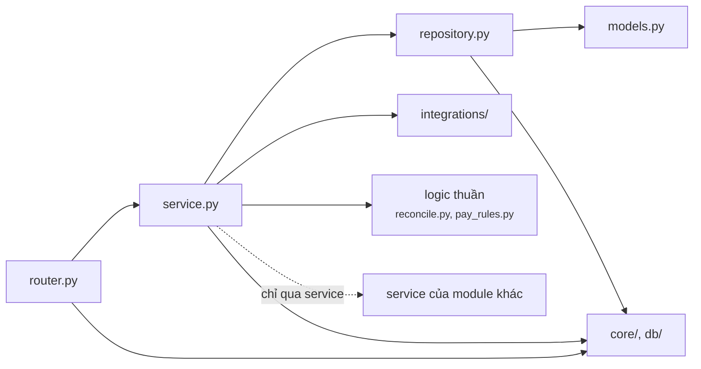

# Bước 8 — Cấu trúc code

Khung thư mục đã tạo thật trong repo. Mỗi file có docstring ghi rõ nó chịu trách nhiệm gì, nhưng chưa có logic nghiệp vụ. Bước 9 chỉ việc điền code vào đúng chỗ. Khung đã chạy được: `pytest` và `ruff` của backend và dịch vụ nhận diện đều pass, `docker compose config` hợp lệ.

## 1. Toàn repo

```text
hybrid-checkout/
├── api/                     # Bước 6 — contract OpenAPI (nguồn gốc của API)
├── database/                # Bước 5 — schema.dbml (nguồn gốc), extras.sql, schema.sql (sinh), test.sql
├── frontend/                # Web app React + TypeScript (prototype Bước 4, nối API ở Bước 9)
├── backend/                 # Backend API + Worker + Trainer: một package Python, ba tiến trình
├── inference/               # Dịch vụ nhận diện: bọc model, không nghiệp vụ, không DB
├── infra/nginx/             # Cấu hình nginx: phục vụ web app, chuyển /api sang backend
├── scripts/                 # Sinh và kiểm tra: schema, sơ đồ ER, contract API, ảnh mẫu
├── docs/                    # Tài liệu Bước 1–8
├── .github/workflows/ci.yml # CI: contract, schema, frontend, backend
├── docker-compose.yml       # Cả hệ thống trên một máy (C4 mục 6)
└── .env.example             # Mọi biến môi trường; chép thành .env, không commit .env
```

Mỗi container ở C2 ([Bước 7](07-c4.md)) ứng với đúng một thư mục: Web app → `frontend/`, Backend API / Worker / Trainer → `backend/` (cùng code, khác lệnh chạy), Dịch vụ nhận diện → `inference/`.

## 2. Backend

```text
backend/
├── pyproject.toml           # phụ thuộc (uv), ruff, pytest; extra [ml] cho trainer
├── uv.lock                  # khóa phiên bản, commit cùng code
├── Dockerfile               # 3 target: api, worker, trainer
├── alembic.ini
├── migrations/versions/
│   └── 0001_baseline.py     # chạy database/schema.sql
├── app/
│   ├── main.py              # tạo FastAPI app, gắn router dưới /api/v1
│   ├── core/                # dùng chung: config, security, errors (problem+json), deps (DB, user, role), logging
│   ├── db/                  # engine, session, DeclarativeBase
│   ├── integrations/        # adapter ra ngoài: camera, inference, storage (S3), queue (Celery)
│   ├── modules/             # nghiệp vụ, một thư mục cho mỗi nhóm tag OpenAPI (mục 3)
│   │   └── <module>/
│   │       ├── router.py    # HTTP: nhận/kiểm tra request, phân quyền, gọi service
│   │       ├── schemas.py   # Pydantic: body request/response, tên giống schema trong contract
│   │       ├── service.py   # use case + quy tắc BR, một transaction DB mỗi thao tác
│   │       ├── repository.py# truy vấn SQLAlchemy
│   │       └── models.py    # ánh xạ bảng của module
│   └── worker/
│       ├── celery_app.py    # hàng đợi cpu/gpu, lịch định kỳ
│       └── tasks/           # cutouts, composites, training, evaluation, retention, cameras
└── tests/
    ├── unit/                # logic thuần: đối chiếu, khóa thanh toán, ưu tiên hậu kiểm
    ├── integration/         # service + route với PostgreSQL thật
    └── contract/            # so /openapi.json của app với api/openapi.yaml
```

**Chiều phụ thuộc** (chỉ đi xuống, không đi ngược):



| Quy tắc | Lý do |
|---|---|
| Router không có SQL, không có quy tắc nghiệp vụ | Quy tắc nằm một chỗ; test service không cần HTTP |
| Module khác chỉ được gọi qua `service.py` của nó, không đọc `repository.py` hay `models.py` của nhau | Giữ ranh giới để sau này tách service được (ADR-01) |
| Service không import `boto3`, `httpx`, `celery`; chỉ dùng `integrations/` | Test thay adapter bằng bản giả, không cần camera hay GPU |
| Logic thuần (`reconcile.py`, `pay_rules.py`) không I/O | Unit test nhanh; cùng thuật toán với `frontend/src/lib/reconcile.ts` |
| Lỗi nghiệp vụ ném `ProblemError(code, ...)` từ service; `core/errors.py` trả `problem+json` | Mã lỗi khớp contract (docs/06 mục 5) |
| Nhật ký ghi bằng `system/audit.py` trong cùng transaction | Không có thay đổi nào thiếu nhật ký (US27) |

## 3. Module ↔ contract ↔ dữ liệu

| Module | Tag OpenAPI | Bảng sở hữu | Thành phần C3 | Use case |
|---|---|---|---|---|
| `auth` | Auth, Profile | — (dùng `users` qua service) | Auth & RBAC | UC01–UC03, UC12 |
| `users` | Users | `users` | Auth & RBAC | UC25 |
| `counters` | Counters | `counters` | Checkout | UC26 |
| `shifts` | Shifts | `shifts` | Checkout | UC04, UC11 |
| `checkout` | Checkout | `transactions`, `transaction_lines`, `tray_captures`, `detections`, `manager_approvals` | Checkout, Reconciliation | UC05–UC10, UC12 |
| `alerts` | Alerts | `alerts`, `alert_detections` | Review | UC08, UC14 |
| `catalog` | Catalog | `categories`, `skus` | — | UC15 |
| `batches` | Batches | `import_batches`, `sku_samples` | Dataset | UC16, UC17, UC19 |
| `labeling` | Labeling | `label_tasks`, `annotations` | Dataset | UC18 |
| `jobs` | Jobs | `jobs` | Dataset | UC20 |
| `model_registry` | Models | `model_versions`, `model_version_skus`, `model_deployments`, `model_confusions` | Model registry | UC21, UC22 |
| `thresholds` | Thresholds | `threshold_configs` | Model registry | UC23 |
| `reports` | Reports | — (đọc các view) | Review | UC13, UC24 |
| `system` | System | `settings`, `audit_logs` | Audit log | UC27, UC28 |

Mỗi bảng có đúng một module sở hữu; chỉ module đó ghi vào bảng.

## 4. Dịch vụ nhận diện

```text
inference/
├── pyproject.toml, Dockerfile
├── app/
│   ├── main.py      # FastAPI app
│   ├── routes.py    # /detect, /cutouts, /model, /health (api/inference.openapi.yaml)
│   ├── runtime.py   # nạp 1 checkpoint + class map; file DUY NHẤT import code của model
│   ├── cutout.py    # cắt nền ảnh mẫu
│   ├── schemas.py, config.py
└── tests/
```

Đổi hoặc nâng cấp model chỉ sửa `runtime.py` (D07).

## 5. Frontend

Prototype hiện tại giữ nguyên. Bước 9 thay dữ liệu giả lập bằng API theo cấu trúc dưới đây; giao diện và các component không đổi.

```text
frontend/src/
├── api/                      # MỚI
│   ├── schema.d.ts           # SINH từ api/openapi.yaml (openapi-typescript), không sửa tay
│   ├── client.ts             # openapi-fetch: gắn access token, tự gọi /auth/refresh khi 401
│   └── errors.ts             # đọc problem+json, rẽ nhánh theo code
├── app/                      # router, providers (QueryClient, Auth), quyền theo vai trò
├── layouts/                  # PosLayout, AdminLayout
├── components/               # UI dùng chung: TrayViewer, charts, ui
├── features/
│   ├── pos/                  # P01–P06
│   │   ├── queries.ts        # MỚI: hook TanStack Query gọi api/ (useCheckout, useScanItem…)
│   │   ├── components/
│   │   └── *Page.tsx, *Dialog.tsx
│   ├── store/  ml/  admin/  auth/   # cùng mẫu: queries.ts + components/ + *Page.tsx
├── lib/                      # format, box; reconcile.ts chỉ còn dùng cho demo offline
└── mocks/                    # chỉ cho test và demo không có backend
```

| Quy tắc | Lý do |
|---|---|
| Kiểu dữ liệu API lấy từ `schema.d.ts` sinh từ contract | Contract đổi thì TypeScript báo lỗi ngay ở chỗ dùng |
| Dữ liệu từ server qua TanStack Query (cache, tải lại, trạng thái đang tải/lỗi) | Bỏ `app/store.tsx` tự viết; không giữ bản sao dữ liệu server trong state |
| Màn quầy vẽ từ `Checkout` server trả về, kể cả `pay_blockers` | Không tính lại quy tắc ở trình duyệt |
| Component không gọi `fetch` trực tiếp, chỉ dùng hook trong `queries.ts` | Đổi API chỉ sửa một chỗ |

## 6. Quy ước đặt tên

| Phạm vi | Quy ước | Ví dụ |
|---|---|---|
| Python | module, hàm, biến `snake_case`; class `PascalCase`; hằng `UPPER_CASE` | `checkout/service.py`, `def pay_transaction`, `class PayRequest` |
| Hàm service | trùng `operationId` của contract, viết `snake_case` | `scanItem` → `scan_item` |
| Schema Pydantic | trùng tên schema trong contract | `Checkout`, `ScanRequest` |
| TypeScript | component `PascalCase.tsx`; hook `useXxx`; file khác `camelCase.ts` | `PosPage.tsx`, `useCheckout`, `reconcile.ts` |
| Test | `test_<điều được kiểm>.py` / `<file>.test.ts`, đặt cạnh loại test tương ứng | `tests/unit/test_reconcile.py` |
| DB, API | theo Bước 5 và 6: bảng số nhiều `snake_case`, path kebab-case, enum `UPPER_CASE` | `transaction_lines`, `/tray-checks`, `FALSE_ALARM` |

## 7. Cấu hình

- Thứ gì khác nhau giữa các môi trường (URL, mật khẩu, khóa bí mật) nằm trong biến môi trường. `backend/app/core/config.py` đọc chúng và có giá trị mặc định cho máy dev. `.env.example` liệt kê đủ các biến.
- Quy tắc nghiệp vụ mà người dùng chỉnh được (số ngày giữ ảnh, cổng duyệt, hậu kiểm) nằm trong bảng `settings`, không nằm trong biến môi trường.
- Không commit `.env`, khóa bí mật hay ảnh RPC (`.gitignore`).

## 8. Chạy và kiểm tra

```bash
cp .env.example .env
docker compose up --build             # web :8080, api :8000, MinIO console :9001

cd backend && uv sync                 # máy dev, không Docker
uv run uvicorn app.main:app --reload  # http://localhost:8000/api/docs
uv run ruff check . && uv run pytest

scripts/check_api.sh                  # lint contract
scripts/check_schema.sh               # test DB
```

CI ([`.github/workflows/ci.yml`](../.github/workflows/ci.yml)) chạy đủ các lệnh trên ở mỗi pull request. CI cũng kiểm tra `schema.sql` đã được sinh lại sau khi sửa DBML.

## 9. Thứ tự làm ở Bước 9

1. `core/` và `db/`: config, lỗi, session, xác thực, `require_role`; sinh model SQLAlchemy theo `schema.sql`.
2. `checkout` cùng `reconcile.py` và `pay_rules.py`: đây là luồng chính tại quầy. Viết unit test chuyển từ `frontend/src/lib/reconcile.test.ts`.
3. `auth`, `shifts`, `counters`, `catalog`: đủ để màn quầy chạy với backend thật.
4. `alerts`, `reports`, rồi đến `batches`, `labeling`, `jobs`, `model_registry`, `thresholds` và worker.
5. Frontend: sinh `schema.d.ts`, thay `app/store.tsx` bằng `queries.ts` theo từng khu vực.
6. Test contract: so `/api/v1/openapi.json` với `api/openapi.yaml` (schemathesis).
